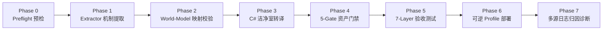

# Agent Harness: Turning Any Gameplay into a GTA World-Model Mod (`HARNESS.md`)

> **定位**：面向 AI Coding Agents（Antigravity、Claude Code、Codex、Cursor 等）的**8 阶段标准作业程序 (Standard Operating Procedure, SOP)**。  
> **使命**：将任何已获授权的玩法需求文档（`.md`/`.yaml`）、开源/自研游戏代码仓库或结构化业务数据（如公交线网 `.xml`、港区物流调度单 `.json`），系统化、可验证、可逆地转译为运行在 **GTA V（同时支持 Enhanced / Gen9 与 Legacy / Gen8）** 开放世界载体上的高可靠模组。

---

## 核心哲学：为什么不能让大模型直接「裸写」GTA 脚本？

直接用 Prompt 让大模型生成一段 `ScriptHookVDotNet` C# 脚本存在四大致命工程缺陷：
1. **单步玩具化**：模型往往只写出「按一个键刷出一辆车」的玩具片段，缺失**选配 → 流式载入 → 出车就位 → 站序/任务推进 → 结算 → 确定性卸载 (`Teardown`)** 的完整运营闭环。
2. **UI 与重型实体生成耦合崩溃**：在菜单滚动回调（`OnIndexChange`）中同步调用 `World.CreateVehicle` 实时生成 3D 预览车，极易因模型流式未就绪返回 `null` 触发 `NullReferenceException` 或瞬间撑爆系统可提交内存。
3. **版本与资产管线失配**：忽视 **GTA V Enhanced (Gen9)** 与 **Legacy (Gen8)** 的 `.yft` (`v171` vs `v162`) / `.ytd` (`v5` vs `v13`) 二进制差异，尤其是仪表渲染目标贴图 `script_rt_*` 在 Gen9 下使用遗留 `DXT1` 格式导致的无弹窗闪退。
4. **污染宿主目录与不可逆部署**：直接把 `.dll`、`.asi`、数 GB 的 `dlc.rpf` 混装进游戏根目录，缺乏文件锁、进程守卫与 SHA-256 事务回滚，一旦冲突只能重装游戏。

`GTA-Anything` 融合 **`CLI-Anything`（多阶段 SOP + `--json` Agent CLI + `SKILL.md`）**、**`REA`（带证据锚点的机制提取 `Gameplay IR`）** 与 **`AnyPS5`（洁净室运行时 SDK `GtaAnything.Runtime` + 静态资产重定目标审计）**，规定所有 Agent 必须严格按以下 **8 阶段管线 (Phase 0 – Phase 7)** 推进工作。

---

## 8 阶段标准作业管线总览 (The 8-Phase Pipeline)



---

## Phase 0: Environment & Clean-Room Preflight (`gta-anything preflight`)

在读取任何源码或生成任何一行 C# 代码之前，Agent 必须先验证宿主环境健康度、游戏构建版本与热键冲突。

### 执行步骤
1. **调用预检 CLI**：
   ```bash
   gta-anything --json preflight --game-dir "<GAME_INSTALL_DIR>" --hotkey F9
   ```
2. **核查系统资源红线**：
   - **磁盘余量 (`disk_free_gb`)**：目标磁盘剩余空间必须 `>= 10.0 GB`（挂载 `mods/` 下的 `.rpf` 副本前必须确保余量充足，防止磁盘写满引发系统级异常）。
   - **系统可提交内存 (`commit_available_mb`)**：计算 `CommitLimit - CommittedBytes`。若低于 `1536 MB` 发出告警；低于 `1024 MB` 时**严禁启动高负载实机测试**，避免将虚拟内存枯竭导致的 DirectX/引擎无弹窗退出误判为脚本逻辑 Bug。
3. **显式记录双构建号 (Dual Build Identity)**：
   - 同时记录磁盘可执行文件版本（`exe_version`，如 `1.0.1158.16`）与 `ScriptHookV.log` 内部识别枚举别名（`shv_build_alias`，如 `VER_EN_1_0_1158_13`）。
   - 识别目标版本属于 `enhanced_gen9`（`GTA5_Enhanced.exe`）还是 `legacy_gen8`（`GTA5.exe`）。
4. **双加载链与进程守卫**：
   - 确认游戏相关进程（`GTA5_Enhanced`, `GTA5`, `PlayGTAV`, `RAGEPluginHook`）均未运行（`processes_clear == true`）。
   - 区分 **SHVDN/ASI 链**（`dinput8.dll` → `ScriptHookV.dll` → `ScriptHookVDotNet.asi` → `scripts/`）与 **RPH 链**（`RAGEPluginHook.exe` → `plugins/`）。
5. **热键冲突矩阵预检**：
   - 避开高危保留键：`F4` (RPH 控制台)、`Insert` (SHVDN 重载)、`F3`/`F8` (常见 Trainer)、`B`/`N`/`E`/`Y` (LSPDFR/原版喇叭与交互高频键)。推荐使用带修饰键组合（如 `LeftShift + F9` 或 `F10`）。
6. **洁净室合规自检**：
   - 确认工作区不包含任何 Rockstar 原生二进制、未授权第三方 `.dll`/`.asi`/`.rpf` 或带有个人计算机用户名/路径的日志文件。

---

## Phase 1: Evidence-Backed Mechanism Extraction (`gta-anything extract`)

借鉴 `REA (Reverse Engineer Anything)`，**严禁仅凭直觉脑补玩法结构**。必须从授权输入（需求文档 `spec.md`、业务配置 `routes/*.xml` 或源码目录）中提取带证据锚点 (`EvidenceAnchor`) 的中间表示 `Gameplay IR (G-IR)`。

### 执行步骤
1. **运行提取器（支持文档/XML 与多语言源码仓库 AST 提取）**：
   ```bash
   gta-anything --json extract examples/metro_shuttle_loop/spec.md -o gameplay_ir.json --edition enhanced_gen9
   # 或直接从外部 Python/JS/C#/Lua 小游戏源码目录提取并自动投影 2D 坐标至洛圣都真实街区路网：
   gta-anything --json extract examples/external_pizza_rush_src -o pizza_ir.json --edition enhanced_gen9
   ```
2. **拆解四大核心契约**：
   - **角色与实体槽位 (`entities`)**：区分玩家执勤载具（`is_player_vehicle: true`）与交互 NPC（乘客、调度员、目标货车）。
   - **空间拓扑轨迹 (`routes_or_zones`)**：
     - 固定线路模式 (`ordered_stops`)：有序站点坐标 `(x, y, z)`、驻留秒数 `dwell_seconds`、单次票价 `fare_or_reward`。
     - 区域调度模式 (`dispatch_zones`)：执勤起点、巡检/交接区坐标、驻留交互时长与奖励。
   - **完整运营状态机 (`state_machine`)**：必须显式包含 `standby` (`Idle`) → `ui` (`MenuSelecting`) → `streaming` (`ResourceStreaming`) → `spawning` (`SpawningShift`) → `operation` (`ActiveRoute` / `ActiveDispatch`) → `completion` (`ShiftSummary`) → `cleanup` (`Teardown`)。
   - **证据锚点 (`evidence`)**：每一条核心机制必须记录 `source_file`、`locator`（如 `"L12-L28"` 或 `"xml:route/stop[0]"`）、`extracted_fact` 与 `confidence`。

---

## Phase 2: World-Model Mapping & Vanilla-First Baseline Design (`gta-anything validate-ir`)

在进入代码生成前，必须验证 `Gameplay IR` 是否符合 GTA 世界模型安全不变量，并落实 **「原版基线先行 (Vanilla-First Baseline)」** 铁律。

### 执行步骤
1. **执行 IR 静态不变量校验**：
   ```bash
   gta-anything --json validate-ir gameplay_ir.json
   ```
2. **五大强制不变量核查**：
   - **Invariant 1 — 原版兜底完整性 (`vanilla_fallback_model`)**：每个 `EntitySlot` 必须绑定合法的 GTA V 原版内置模型（如公交使用 `bus` / `airbus` / `coach`，货运使用 `mule` / `benson` / `pounder`，调度员使用 `s_m_m_dockwork_01` / `a_m_y_business_01`）。即使 `preferred_addon_model` 留空或流式加载失败，纯靠原版模型也必须能 100% 跑通全流程！
   - **Invariant 2 — 菜单与 3D 实体生成彻底解耦 (`preview_mode != "live_3d_spawn"`)**：`ui_spec.preview_mode` 仅允许 `"static_metadata"` 或 `"static_sprite"`，从根源上消灭菜单快速滚动时的 `NullReferenceException`。
   - **Invariant 3 — 状态机正向可达与反向必达 `Teardown`**：
     - 从 `initial_state` 出发，所有状态节点必须可达（无孤立死状态）；
     - 任何处于 `streaming`、`spawning`、`operation`、`completion` 阶段的状态，必须存在有向路径到达 `cleanup_state` (`Teardown`)，保证任务成功、玩家主动取消或载具损毁时均能触发确定性清理。
   - **Invariant 4 — 热键无裸单键冲突**：检查 `inputs.activation_key` 与 `avoid_conflicts_with`。
   - **Invariant 5 — 洁净室开源许可证**：`meta.license` 必须明确（如 `MIT`、`Apache-2.0`），严禁 `proprietary-unlicensed`。

---

## Phase 3: Clean-Room C# Transpilation onto `GtaAnything.Runtime` (`gta-anything transpile`)

将通过校验的 `Gameplay IR` 转译为基于 `GtaAnything.Runtime` 洁净室兼容层 SDK 的 C# 模组工程。

### 执行步骤
1. **调用转译器生成 C# 模组工程并编译 PE `.dll` 产物 (`transpile` + `build-dll`)**：
   ```bash
   gta-anything --json transpile gameplay_ir.json -o build/metro_shuttle_loop
   # 离线洁净室编译（输出 GtaAnything.Runtime.dll 与 <ModClassName>.dll，校验 PE MZ 头）
   gta-anything --json build-dll build/metro_shuttle_loop --edition enhanced_gen9
   # 若传入用户本地游戏目录 --game-dir，则自动只读探测 ScriptHookVDotNet3.dll / RAGEPluginHook.dll 并链接实机脚本：
   gta-anything --json build-dll build/metro_shuttle_loop --game-dir "<GAME_DIR>" --edition enhanced_gen9
   ```
2. **检查生成的四大核心工件**：
   - `<ModClassName>.csproj`：同时包含 `GTAV_ENHANCED` (Gen9) 与 `GTAV_LEGACY` (Gen8) 条件编译配置，并引用 `GtaAnything.Runtime`。
   - `ModEntrypoint.cs`：严格组合 `GtaAnything.Runtime` 的五大核心原语：
     1. **`WorldSession`（租约式实体清理）**：所有生成的 `Vehicle`、`Ped`、`Blip`、`Prop` 必须通过 `session.LeaseVehicle(...)` / `session.LeasePed(...)` 登记；退出或异常时调用 `session.DisposeAll()`，**只清理本模组租约实体，绝不无差别清空世界**。
     2. **`OperationalStateMachine`（确定性生命周期状态机）**：驱动从 `Idle` 到 `Teardown` 的状态流转，任何未捕获异常自动跳转 `Teardown`。
     3. **`SafeModelStreamer`（超时释放 + 原版回退）**：请求 `preferred_addon_model` 超时（如 5000ms）后，**必须立即调用 `MarkAsNoLongerNeeded()` 释放悬空流式请求**，再无缝回退加载 `vanilla_fallback_model`。
     4. **`DecoupledMenuController`（静态预览菜单控制器）**：在 `OnIndexChange` 期间只切换静态元数据卡片或 2D Sprite，绝不触发 `CreateVehicle`。
     5. **`PhasedJsonLogger`（7 层验收证据日志器）**：按 L1–L7 阶段向 `<mod_id>.telemetry.jsonl` 写入结构化事件，供 Phase 7 自动化诊断关联。
   - `<ModClassName>Config.json`：外置热键、路线坐标、票价与车型配置，支持免重编译微调。
   - `BUILD_AND_VERIFY.md`：生成的针对性构建与 L1–L7 验收核对单。

---

## Phase 4: 5-Stage Gen8/Gen9 Asset Verification Gate (`gta-anything asset-check`)

当模组在原版基线（Vanilla Baseline）跑通后，若用户需要挂载自定义 Add-on 载具或纹理资产（`.yft` / `.ytd` / `.dds` / `dlclist.xml`），必须依次通过 **五道独立资产门禁 (5-Stage Asset Gates)**。

### 执行步骤
1. **运行静态资产审计器（Gate 1 & Gate 2）与自动修复重编码 (`asset-fix`)**：
   ```bash
   gta-anything --json asset-check <ASSET_DIR_OR_FILE> --edition enhanced_gen9
   # 若发现遗留 DXT1/DXT3/DXT5 多 mip script_rt_* 纹理或 dlclist.xml 格式问题，可先 --dry-run 预演后自动重编码为单 mip B8G8R8A8_UNORM：
   gta-anything --json asset-fix <ASSET_DIR_OR_FILE> -o <FIXED_DIR> --edition enhanced_gen9 --dry-run
   gta-anything --json asset-fix <ASSET_DIR_OR_FILE> -o <FIXED_DIR> --edition enhanced_gen9
   ```
2. **逐门禁核验标准**：

| 门禁 | 阶段类型 | 核验内容与 Gen8 / Gen9 关键判据 |
| :--- | :--- | :--- |
| **Gate 1: 静态二进制审计** | 离线静态 (`asset-check`) | 解析 RSC7 (`0x37435352`) / RSC8 头部版本：**Gen9 (`enhanced_gen9`)** 要求 `.yft` 版本为 **`171`**、`.ytd` 版本为 **`5`**（若检测到遗留 Gen8 `.yft = 162` 或 `.ytd = 13` 立即阻断报错）。<br>**高危规则 (`script_rt_*`)**：扫描仪表盘渲染目标纹理（如 `script_rt_dials_race`）。在 Gen9 下若仍为 `DXT1` 或 `mipCount > 1` 会导致游戏无弹窗崩溃，必须转换为 **单 mip (`mip=1`) `B8G8R8A8_UNORM`**！ |
| **Gate 2: DLC 注册核验** | 离线静态 (`asset-check`) | 校验 `dlclist.xml` XML 良构性，确认 `<Item>dlcpacks:/<addon_name>/</Item>` 路径规范，且仅在 `mods/` 副本中修改，绝不篡改原版归档。 |
| **Gate 3: 引擎流式载入** | 运行时 (`SafeModelStreamer`) | 轮询 `RequestModel` 并在 `stream_timeout_ms` 超时后立即调用 `MarkAsNoLongerNeeded()`，平滑回退 `vanilla_fallback_model`。 |
| **Gate 4: 世界实体生成** | 运行时 (`WorldSession`) | 调用 `CreateVehicle` 后强制校验返回值非 `null` 且 `Exists() == true`，落地平稳后再设置涂装、车牌或镜头。 |
| **Gate 5: 业务交互闭环** | 运行时 (`ActiveOperation`) | 验证玩家入座驾驶位、车门骨骼开关、NPC 乘客/协调员寻路上下车及计费结算均无卡死。 |

---

## Phase 5: 7-Layer Acceptance Planning & Offline Verification (`TEST.md`)

借鉴 `CLI-Anything` 的 `TEST.md` 双阶段法，所有模组与工具链交付必须建立 **7 层验收证据阶梯 (L1–L7 Acceptance Evidence Ladder)**。

### 7 层验收证据阶梯定义 (`ACCEPTANCE_LAYERS`)
- **L1 — `static_integrity`（配置与资产静态可读）**：`GameplayIR` 通过 `validate-ir`，外部 JSON/XML 配置良构，静态资产通过 Gate 1 & Gate 2。
- **L2 — `loader_recognition`（加载器成功识别）**：`ScriptHookV.log` / `ScriptHookVDotNet.log` 正常识别游戏构建号并发现模组程序集。
- **L3 — `script_initialized`（脚本初始化成功）**：模组 `ModEntrypoint` 完成构造、配置加载与热键绑定，写入 L3 JSONL 遥测事件。
- **L4 — `menu_responsive`（菜单安全唤起与静态浏览）**：按下激活热键唤起菜单，无抢键冲突，快速上下滚动路线/车型列表时不生成 3D 实体、零 `NullReferenceException`。
- **L5 — `session_started`（班次/任务正式启动）**：确认选配后，`SafeModelStreamer` 成功载入模型（或触发原版兜底），执勤车辆非空生成并登记至 `WorldSession`。
- **L6 — `core_loop_completed`（核心业务循环完整跑通）**：按序完成所有公交站点停靠上下客计费，或完成港区调度巡检交接，进入结算界面。
- **L7 — `clean_teardown`（确定性清理与句柄释放）**：正常完班、中途中止或脚本重载时，`WorldSession.DisposeAll()` 释放全部租约车辆、NPC、Blip 及模型流式句柄，世界恢复干净状态。

### 离线自动化测试执行
```bash
python -m pytest -v
gta-anything --json pipeline examples/metro_shuttle_loop/spec.md -o <TMP_OUT_DIR> --edition enhanced_gen9 --compile
```

---

## Phase 6: Reversible Profile Isolation & Deployment (`gta-anything profile`)

**严禁将不同加载链或按键重叠的重型模组强行混装在同一运行目录**。必须使用 `ProfileManager` 进行事务化、可逆的 Profile 隔离管理。

### 执行步骤
1. **始终先以 `--dry-run` 预演部署与切换计划**：
   ```bash
   gta-anything --json profile stage transit_profile build/metro_shuttle_loop --game-dir "<GAME_DIR>" --dry-run
   gta-anything --json profile switch transit_profile --game-dir "<GAME_DIR>" --dry-run
   ```
2. **四大安全机制保障**：
   - **独占锁文件 (`switch.lock`)**：防止并发切换损坏目录结构。
   - **存活进程守卫**：切换前再次校验 `GTA5_Enhanced.exe` / `GTA5.exe` / `RAGEPluginHook.exe` 未运行。
   - **非活跃停靠区 (`Inactive/<profile_name>`) + NTFS 原地重命名/Junction**：切换 Profile 时通过原子移动 (`os.rename`) 将非活跃插件与重型目录移入停靠区，无需重复拷贝数 GB 的 `.rpf` 文件。
   - **SHA-256 事务清单与一键回滚 (`rollback`)**：每次变更生成包含 `operations` 与 `sha256_map` 的 `DeploymentManifest`，任何异常可执行：
     ```bash
     gta-anything --json profile rollback --game-dir "<GAME_DIR>"
     ```

---

## Phase 7: Phased Multi-Log Triage & Skill Packaging (`gta-anything diagnose`)

当实机运行出现崩溃、卡死、模型刷不出或菜单无响应时，**严禁盲目猜测修改代码**。必须使用多源日志关联诊断器定位精确的失败层级（L1–L7）与根因分类。

### 执行步骤
1. **调用多源日志关联诊断器**：
   ```bash
   gta-anything --json diagnose ScriptHookV.log ScriptHookVDotNet.log metro_shuttle_loop.telemetry.jsonl --commit-mb 1800
   ```
2. **四大根因归类与标准处置方案**：
   - **`environment`（环境与系统资源枯竭）**：
     - *典型特征*：`commit_available_mb < 1024`、DirectX 显存/内存分配失败、磁盘剩余空间不足。
     - *处置*：清理后台高内存进程、扩容系统分页文件或清理冗余 `.rpf` 副本，**不要误改模组业务代码**。
   - **`loader`（加载链失配或热键抢占）**：
     - *典型特征*：`ScriptHookV.log` 报 `unknown game version`、`exe_version` 与 `shv_build_alias` 映射断裂、RPH `F4` 或 Trainer 抢占按键。
     - *处置*：更新对应构建号的加载器，或在 `<ModClassName>Config.json` 中调整 `activation_key` + `modifier_key`。
   - **`asset`（Gen8/Gen9 资产不兼容或流式超时）**：
     - *典型特征*：加载包含 `DXT1` `script_rt_dials_*` 的 Gen9 载具后瞬间闪退，或 `SafeModelStreamer` 连续触发超时回退。
     - *处置*：先切回 `vanilla_fallback_model` 验证脚本 L1–L7 闭环；再用 `gta-anything asset-check` 修复 `.yft`(v171)/`.ytd`(v5) 及 `script_rt_*` 单 mip `B8G8R8A8_UNORM` 纹理。
   - **`script_logic`（脚本空引用或生命周期泄漏）**：
     - *典型特征*：`ScriptHookVDotNet.log` 捕获 `NullReferenceException`（如菜单预览直接操作未就绪实体），或停留在 L5/L6 未到达 L7 `Teardown`。
     - *处置*：检查是否违反 UI-Spawn 解耦铁律，确保所有实体均纳入 `WorldSession` 租约与 `OperationalStateMachine` 异常兜底。

---

## 铁律速查清单 (Non-Negotiable Checklist for Every Agent)

- [ ] **绝不提交私有/侵权二进制与个人路径**：仓库中零 `.dll`/`.asi`/`.rpf`/`.yft`/`.ytd`，零个人机器绝对路径。
- [ ] **双构建号显式记录**：始终同时追踪磁盘 `exe_version` 与 SHV `shv_build_alias`。
- [ ] **原版基线先行**：每个实体槽位必填 `vanilla_fallback_model`，超时后必调 `MarkAsNoLongerNeeded()`。
- [ ] **菜单零 3D 实时生成**：`ui_spec.preview_mode` 严禁设为 `live_3d_spawn`。
- [ ] **完整 L1–L7 闭环与 `WorldSession` 租约**：所有运行态必须能回到 `Teardown`，只清理自己租约内的实体。
- [ ] **Gen9 资产必过 5 道门禁**：`.yft` v171、`.ytd` v5、`script_rt_*` 必须为单 mip `B8G8R8A8_UNORM`。
