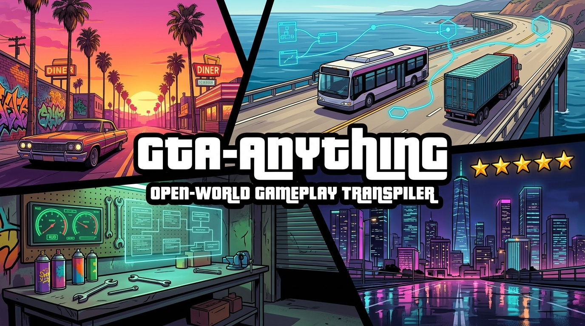
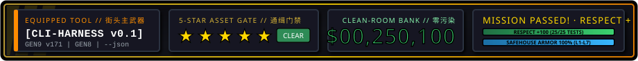
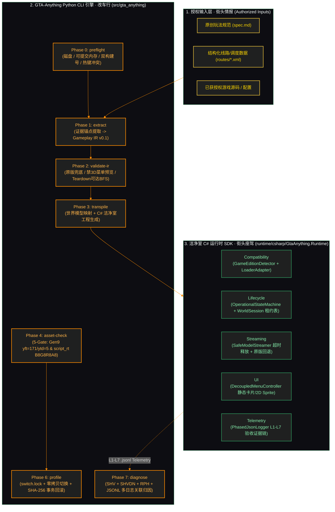
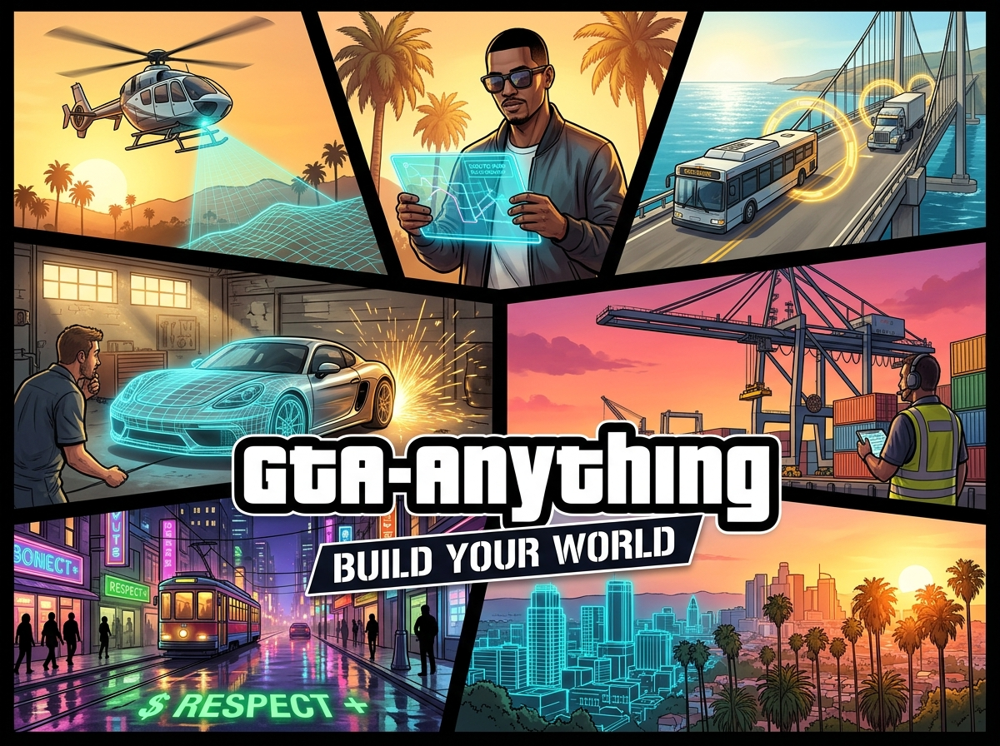

<div align="center">





# 🌴 GTA-Anything 🌆

### `WELCOME TO LOS SANTOS` · Street-Grade Gameplay Transpiler

> **"街头即画布，洛圣都即引擎 —— 把任何玩法规则直接空投进开放世界街头运行。"**  
> *"Why build a city from scratch when the streets are already alive? Turn any gameplay spec, route sheet, or open-source mechanics into a street-ready GTA World-Model Mod."*

**以 GTA 开放世界为通用「世界模型载体」的 Agent-Native 玩法提取、洁净室转译与可逆部署验证框架**

[](LICENSE)
[](pyproject.toml)
[](runtime/csharp/GtaAnything.Runtime)
[](docs/ARCHITECTURE.md)  
[](tests/TEST.md)
[](#wanted-gate)
[](HARNESS.md)
[](#code-of-the-streets)

<p align="center">
  <a href="#the-turf">🗺️ 街头版图 (Street Turf)</a> ·
  <a href="#wasted-vs-respect">💀 WASTED vs RESPECT+</a> ·
  <a href="#the-crew">📻 电台结盟 (Crew)</a> ·
  <a href="#architecture">🏗️ 帮派蓝图 (Architecture)</a> ·
  <a href="#pay-n-spray">🔧 改车行流水线 (Pay 'n' Spray 8-Phase)</a> ·
  <a href="#quickstart">⚡ 60秒抢滩 (Quickstart)</a> ·
  <a href="#safehouse">🏠 安全屋撤离 (Safehouse Profiles)</a> ·
  <a href="#contracts">🌴 街头委托 (Contracts)</a> ·
  <a href="#english-turf">🌐 English Turf</a>
</p>

</div>


<a id="the-turf"></a>

## 🗺️ THE TURF · 为什么把洛圣都当作通用「世界模型街头基底」？

> 📟 *Lamar's pager:* "Yo homie, why you hand-rolling a whole city? The block's already poppin'."

为什么要从零手写刚体车辆物理、交通流 AI、道路寻路网格 (NavMesh)、昼夜天气光照与第三人称镜头系统？  
**Grand Theft Auto V (Enhanced Gen9 & Legacy Gen8)** 本身就是一座历经十年工业级打磨、**已经活着的街头大都会** —— 一个现成的**三维交互世界模型基底 (Universal World-Model Substrate)**：

| 🏙️ 街头早已在跑的系统 | 在 `GTA-Anything` 里它是什么 |
| :--- | :--- |
| 🚦 Traffic AI & 行人 (Peds) | 免费的群体仿真与 NPC 交互层 |
| 🚗 Vehicle Physics | 现成的刚体载具动力学 |
| 🛣️ Highway NavMesh / 路网 | 线路、站点与调度轨迹的空间锚 |
| 🌦️ Weather / Day-Night | 环境变量与情景压力测试 |
| 🎥 Cameras / HUD | 观察、遥测与 UI 叠加层 |

AI Agent 要做的只有一件事：**把新的玩法规则空投到街区上 (drop new rules onto the block)**。

但当开发者直接用大模型 “Vibe Coding” 生成 GTA 玩法脚本或混装资产时，几乎都会被四种死法当街放倒：菜单预览崩溃、流式句柄泄漏、Gen9 资产闪退与多模组混装污染。**`GTA-Anything`** 把街头生存经验固化为**编译器级形式化不变量 (`Gameplay IR`) + 洁净室 C# 运行时 (`GtaAnything.Runtime`) + 5 道静态资产门禁**。

<a id="wasted-vs-respect"></a>

## 💀 WASTED vs 🏆 MISSION PASSED (RESPECT +)

| # | 💀 **WASTED** · 传统 Vibe-Coded 脚本死法 | ☠️ 真实故障根因 (Root Cause) | 🏆 **MISSION PASSED · RESPECT +** 架构级解药 |
| :---: | :--- | :--- | :--- |
| **1** | **菜单一滚就 WASTED (`NullReferenceException`)** | 在 `OnIndexChange` 菜单回调中同步调用 `CreateVehicle` 生成 3D 预览车；模型未就绪返回 `null` 后直接访问属性，或高频刷车撑爆流式池 | **UI 与实体生成强制解耦 (`UI-Spawn Decoupling`)**：G-IR 编译器静态拒绝 `live_3d_spawn`；`DecoupledMenuController` 仅允许静态元数据卡片或 2D Sprite 贴图预览，实体生成推迟到 `ConfirmSelection` |
| **2** | **逃跑车永远不来 —— 流式加载超时死锁 / 退游挂死** | Add-on 车辆在 `dlclist.xml` 登记后流式请求超时，脚本未调用 `MarkAsNoLongerNeeded` 留下悬空句柄，导致后续流式请求全部阻塞 | **原版逃跑车先行 + 超时自动释放 (`SafeModelStreamer`)**：每个实体槽强制声明 `vanilla_fallback_model`（如 `bus` / `mule`），超时立即调用 `ReleaseModelRequest` 释放句柄，平滑降级为原版 getaway car |
| **3** | **Gen8 老资产开进 GTA V Enhanced —— 秒退** | Gen9 严格要求 `.yft` (`v171`) / `.ytd` (`v5`)；`script_rt_dials_*` 车载仪表渲染目标若沿用 `DXT1` 压缩会直接触发 D3D12 渲染管线崩溃 | **5-Star Heat Asset Check (`5-Gate Gen8/Gen9 Asset Auditor`)**：离线静态解析 RSC7/RSC8 头部与纹理字节，精准拦截 `script_rt_dials_*` 的 `DXT1` 并指导转换为单 mip `B8G8R8A8_UNORM` |
| **4** | **多帮派混战 —— 抢键、虚存耗尽、无法回滚** | `RPH` (`F4`) 与 `SHVDN` (`Insert`) 双加载链混装、游戏 Exe 磁盘版本与 SHV 枚举别名混淆、系统可提交内存低于 `1 GB` 引发无日志闪退 | **环境预检 (`preflight`) + 安全屋事务隔离 (`Safehouse Profile Stash` / `ProfileManager`)**：检测磁盘/可提交内存/双构建号，基于 `switch.lock`、原地零拷贝移动与 SHA-256 清单实现零痕迹秒级切换与一键原子回滚 |


<a id="the-crew"></a>

## 📻 RADIO LOS SANTOS · 三大开源街头盟友 (The Crew)

> 🎙️ *"You're listening to Radio Los Santos — tonight's crew: three open-source legends rolling deep."*

`GTA-Anything` 汲取并融合了三个标杆开源工程的核心思想，把 GTA 模组开发从 “手工作坊脚本” 升级为**确定性 Agent 编译管线**：

| 🎧 Crew Member | 🔥 街头绝活 (核心工程哲学) | 🧰 在 `GTA-Anything` 中的落地实现 |
| :--- | :--- | :--- |
| **[`HKUDS/CLI-Anything`](https://github.com/HKUDS/CLI-Anything)**<br>*The Fixer* | **Agent-Native Harness & Structured CLI**<br>让任何专业软件通过标准 SOP 与 `--json` CLI 成为 AI Agent 的确定性工具 | 8 阶段 [`HARNESS.md`](HARNESS.md) 方法论、全命令支持 `--json` 输出的 `gta-anything` CLI，以及开箱即用的 [`skills/gta-anything/SKILL.md`](skills/gta-anything/SKILL.md) 技能包 |
| **[`morluto/rea`](https://github.com/morluto/rea)**<br>*(Reverse Engineer Anything)*<br>*The Informant* | **Evidence-Backed Mechanism Extraction**<br>拒绝大模型幻觉 —— 每条提取出的状态机与参数必须绑定源码/文档行级证据锚点，没证据就不算数 | `extract` 阶段将 Markdown 玩法规范、XML 线路数据或授权源码解析为 **`Gameplay IR (G-IR v0.1)`**，并强制携带 `EvidenceAnchor` (`source_file` + `locator` + `confidence`) |
| **[`boykopovar/AnyPS5`](https://github.com/boykopovar/AnyPS5)** & **`XenonRecomp`**<br>*The Mechanic* | **Clean-Room Runtime & Static Re-targeting**<br>零专有二进制分发，通过洁净室兼容层抹平代际 ABI 差异并静态校验二进制资产 | 100% 原创 MIT 洁净室 C# 运行时 (`GtaAnything.Runtime`)，内置 Gen9 (`GTA5_Enhanced.exe`) / Gen8 双代际条件编译与 RSC7/RSC8 资产静态审计器 |

<a id="architecture"></a>

## 🏗️ 帮派蓝图 · 系统架构 (Crew Blueprint / System Architecture)



<a id="wanted-gate"></a>

### ⭐ 5-STAR WANTED GATE (`★★★★★`) & L1–L7 STREET CRED LADDER

想让资产上街？先扛过 **1★ 到 5★ 的通缉热度 (Street Heat)**。想拿到 Respect？每一级 **Street Cred** 都要有 `.jsonl` 证据。

| 通缉等级 | 门禁 (`asset-check` Gate) | 检查内容 |
| :--- | :--- | :--- |
| `★☆☆☆☆` | **Gate 1 · Header Check** (RSC Header & RenderTarget) | Gen9 `.yft`=`v171` / `.ytd`=`v5`；`script_rt_dials_*` → `B8G8R8A8_UNORM` |
| `★★☆☆☆` | **Gate 2 · Pack Mounting** | `dlclist.xml` 闭合与 `dlcpacks:/` 路径契约 |
| `★★★☆☆` | **Gate 3 · Spawn & Fallback** | JOAAT 哈希校验与 Vanilla 兜底可生成 |
| `★★★★☆` | **Gate 4 · Layout & Skeleton** | 座椅骨骼 / 车门索引与驾驶舱仪表对齐 |
| `★★★★★` | **Gate 5 · Script Binding → Live Street Interaction** | Gameplay IR 实体槽位与运行时句柄契约一致 |

```mermaid
%%{init: {'theme': 'dark', 'themeVariables': {'primaryColor': '#111111', 'primaryTextColor': '#FFFFFF', 'primaryBorderColor': '#D4AF37', 'lineColor': '#2E8B57', 'clusterBkg': '#0d0d12', 'clusterBorder': '#FF8C00', 'fontFamily': 'Consolas, monospace'}}}%%
flowchart LR
    subgraph Gates["Phase 4: 5-STAR WANTED GATE (asset-check)"]
        G1["★☆☆☆☆ Gate 1: RSC Header & RenderTarget\nGen9 .yft=v171 / .ytd=v5\nscript_rt_dials_* -> B8G8R8A8_UNORM"]
        G2["★★☆☆☆ Gate 2: Pack Mounting\ndlclist.xml 闭合与\ndlcpacks:/ 路径契约"]
        G3["★★★☆☆ Gate 3: Spawn & Fallback\nJOAAT 哈希校验与\nVanilla 兜底可生成"]
        G4["★★★★☆ Gate 4: Layout & Skeleton\n座椅骨骼/车门索引与\n驾驶舱仪表对齐"]
        G5["★★★★★ Gate 5: Script Binding\nGameplay IR 实体槽位与\n运行时句柄契约一致"]
        G1 --> G2 --> G3 --> G4 --> G5
    end

    subgraph Ladder["Phase 5: L1–L7 STREET CRED LADDER"]
        L1["L1 Safehouse Briefing\nStatic Config: 配置与IR静态校验通过"]
        L2["L2 Crew Check-In\nLoader Boot: 双构建号与加载器挂载"]
        L3["L3 Hit The Streets\nScript Init: WorldSession会话初始化"]
        L4["L4 No Showroom Wipeout\nDecoupled UI: 静态卡片/2D贴图菜单无3D生成"]
        L5["L5 Getaway Car Ready\nSafe Stream: 流式加载或超时回退原版载具"]
        L6["L6 Run The Job\nActive Loop: 站点停靠/交互/计酬闭环"]
        L7["L7 Clean Getaway / Zero Heat\nZero-Leak Teardown: 租约实体100%释放归零"]
        L1 --> L2 --> L3 --> L4 --> L5 --> L6 --> L7
    end

    classDef star stroke:#D4AF37,stroke-width:2px,color:#FFD700;
    classDef cred stroke:#2E8B57,stroke-width:2px,color:#86efac;
    classDef getaway stroke:#C41E3A,stroke-width:3px,color:#FFFFFF;
    class G1,G2,G3,G4,G5 star;
    class L1,L2,L3,L4,L5,L6 cred;
    class L7 getaway;
```




<a id="pay-n-spray"></a>

## 🔧 PAY 'N' SPRAY · 8 阶段改车行标准管线 (8-Phase Agent Harness)

> 🧰 *把一张生肉蓝图拖进传说中的地下改车行，开出来就是一台防弹街车。* 完整 SOP 见 [`HARNESS.md`](HARNESS.md)。

| 工位 | CLI 子命令 | 🔩 改装工序 · 核心职责与形式化守卫 | 📦 出厂单据 (产物 / 证据) |
| :--- | :--- | :--- | :--- |
| **Phase 0** · 进厂体检 | `preflight` | 校验磁盘余量、Windows 可提交内存 (`CommitLimit - CommitTotal`)、游戏未运行、双构建号（磁盘 `1.0.1158.16` vs SHV `VER_EN_1_0_1158_13`）及热键冲突 | `PreflightReport` JSON |
| **Phase 1** · 拆车取件 | `extract` | 从 `spec.md`、`routes/*.xml` 或授权源码提取状态机、实体槽位与空间轨迹，绑定行级 `EvidenceAnchor` | `gameplay_ir.json` |
| **Phase 2** · 车架校正 | `validate-ir` | 图论 BFS 验证所有状态可达且所有活跃态均存在有向路径到达 `Teardown`；静态拦截 `live_3d_spawn` 与空 `vanilla_fallback_model` | `ValidationReport` JSON |
| **Phase 3** · 引擎换装 | `transpile` | 将 G-IR 映射至 GTA 世界模型契约，生成支持 `GTAV_ENHANCED` / `GTAV_LEGACY` 条件编译的 C# 模组工程 | `.csproj` + `ModEntrypoint.cs` + `BUILD_AND_VERIFY.md` |
| **Phase 4** · 五星验车 | `asset-check` | 离线执行 5 道资产兼容门禁，识别 Gen8/Gen9 版本错配与 `script_rt_dials_*` `DXT1` 崩溃隐患 | `AssetAuditReport` JSON |
| **Phase 5** · 上路试驾 | *(Runtime)* | `PhasedJsonLogger` 在模组运行期按 `L1`–`L7` 阶梯自动落盘结构化 `.jsonl` 遥测证据 | `<mod_id>_telemetry.jsonl` |
| **Phase 6** · 安全屋入库 | `profile` | 基于 `switch.lock`、进程守卫与 `Inactive/<profile>` 停靠区执行可逆 Profile 暂存、激活与 SHA-256 校验回滚 | `DeploymentManifest` JSON |
| **Phase 7** · 事故鉴定 | `diagnose` | 关联分析 `ScriptHookV.log`、`ScriptHookVDotNet.log`、`RagePluginHook.log` 与 `.jsonl` 遥测，输出根因分类与修复建议 | `DiagnosticReport` JSON |

<a id="quickstart"></a>

## ⚡ 60秒街头抢滩 (Quickstart)

### 1. 上车 · 安装 (`Python 3.10+`)

```bash
pip install -e ".[dev]"
```

### 2. 一脚油门跑完全链路 (`Extract -> Validate -> Transpile -> [Compile] -> Asset-Check -> Simulate -> Visualize`)

```bash
gta-anything --json pipeline examples/metro_shuttle_loop/spec.md \
  -o build/metro_pipeline \
  --edition enhanced_gen9 \
  --compile

# 或者直接把外部 2D Python 小游戏源码仓库一键转译并编译为洛圣都外卖摩托模组：
gta-anything --json pipeline examples/external_pizza_rush_src \
  -o build/pizza_pipeline \
  --edition enhanced_gen9 \
  --compile
```

### 3. 分阶段手动挡 `--json` CLI

```bash
# Phase 0: 环境、可提交内存、双构建号与热键冲突预检
gta-anything --json preflight --hotkey F9

# Phase 1: 从 Markdown 玩法规范 + XML 线路表提取带证据锚点的 Gameplay IR
gta-anything --json extract examples/metro_shuttle_loop/spec.md -o build/metro_ir.json

# Phase 2: 静态校验 Gameplay IR 安全不变量（BFS Teardown 可达性 / 禁 3D 预览 / 原版兜底）
gta-anything --json validate-ir examples/metro_shuttle_loop/gameplay_ir.json

# Phase 3: 转译为洁净室 C# 模组工程（支持 SHVDN 与 RPH 双链 + 2D 静态 SVG 预览卡）
gta-anything --json transpile examples/vinewood_patrol_rph/gameplay_ir.json -o build/VinewoodPatrolRph

# Phase 3B (v0.3.0): 编译 PE .dll 程序集（离线洁净室编译，或传入 --game-dir 链接实机 ScriptHookVDotNet3.dll）
gta-anything --json build-dll build/VinewoodPatrolRph --edition enhanced_gen9

# Phase 4: 5-Gate 静态资产兼容审计（Gen9 .yft v171 / .ytd v5 / script_rt_* B8G8R8A8_UNORM）
gta-anything --json asset-check examples/metro_shuttle_loop --edition enhanced_gen9

# Phase 4B (v0.3.0): 自动重编码遗留 DXT1/多 mip script_rt_* DDS 纹理为单 mip B8G8R8A8_UNORM 并修复 dlclist.xml
gta-anything --json asset-fix build/broken_assets -o build/fixed_assets --edition enhanced_gen9 --dry-run

# M1 离线无头街头仿真器 (Headless Street Simulator): 离线演练 L1-L7 验收与故障注入
gta-anything --json simulate examples/vinewood_patrol_rph/gameplay_ir.json --telemetry-out build/sim_telemetry.jsonl

# M1 洛圣都街头雷达蓝图 (Los Santos Radar Blueprint HTML): 生成零外链交互式拓扑仪表盘
gta-anything --json visualize examples/vinewood_patrol_rph/gameplay_ir.json -o build/radar_blueprint.html

# M1 原版街头目录 (Vanilla Street Catalog): 查询内置原版载具、NPC 与 Blip 预设
gta-anything --json catalog --category emergency

# Phase 6: 可逆 Profile 暂存、切换与回滚（支持 --dry-run 零写入演练）
gta-anything --json profile stage transit --game-dir ./mock_gtav --build-dir build/MetroShuttleLoop --dry-run

# Phase 7: 多日志关联归因诊断（联合分析 SHV + SHVDN + RPH + JSONL + 系统可提交内存）
gta-anything --json diagnose logs/ScriptHookV.log logs/ScriptHookVDotNet.log --commit-mb 2048
```

### 4. 组装座驾 · 编译洁净室 C# 运行时与生成模组 (`.NET SDK`)

```bash
# 编译核心运行时兼容层 SDK (netstandard2.0)
dotnet build runtime/csharp/GtaAnything.Runtime/GtaAnything.Runtime.csproj -c Release

# 编译转译出的模组工程（支持 EnhancedGen9 / LegacyGen8 条件编译）
dotnet build build/MetroShuttleLoop/MetroShuttleLoop.csproj -c Release -p:Edition=EnhancedGen9
```

### 5. 任务结算 · 运行离线自动化测试 (`39/39 MISSION PASSED`)

```bash
pytest -v
```

<a id="safehouse"></a>

### 🏠 安全屋撤离 · 可逆 Profile 部署 (Safehouse Profiles)

> 🔑 *"Lay low, stash the build, leave zero trace."*

`profile` 子命令把每套模组当成一个**安全屋藏货点**：

- 🔒 **`switch.lock` 文件锁 + 进程守卫**：游戏在跑时拒绝换装，杜绝半切换状态。
- 📦 **`Inactive/<profile>` 停靠区 + 原地零拷贝移动**：不复制、不残留，秒级切换。
- 🧾 **SHA-256 `DeploymentManifest`**：每个文件都有指纹，出事一键原子回滚到上一个安全屋。
- 🧪 **`--dry-run`**：先踩点、零写入演练，再真正动手。

<a id="agent-integration"></a>

## 🤖 AI 副驾电台接入 (Agent Skill Integration)

`GTA-Anything` 原生面向 **Claude Code**、**OpenAI Codex**、**Google Antigravity** 与 **Cursor** 等 AI 编程副驾设计，内置完整的方法论契约 [`HARNESS.md`](HARNESS.md) 与技能定义 [`skills/gta-anything/SKILL.md`](skills/gta-anything/SKILL.md)。

### 把 `/gta-anything` 调到你副驾的电台频道

```bash
# 方式 1：将技能目录软链或复制至 Claude Code / Antigravity / Codex 技能发现目录
cp -r skills/gta-anything ~/.claude/skills/

# 方式 2：在对话中直接指令 Agent 加载本地 HARNESS 与 SKILL
```

**📞 给 AI 副驾打的任务电话 (Prompt 示例)**：

> 请阅读仓库根目录的 `HARNESS.md` 与 `skills/gta-anything/SKILL.md`，严格遵循 `/gta-anything` 8 阶段 SOP：  
> 1. 将我的玩法设计文档 `examples/harbor_courier_dispatch/spec.md` 提取并校验为 `Gameplay IR`；  
> 2. 确保遵循 **Vanilla-First 原版兜底**、**UI-Spawn 解耦**与 **`WorldSession` 租约式清理**三大不变量；  
> 3. 调用 `gta-anything --json pipeline` 生成面向 `enhanced_gen9` 的 C# 模组工程并输出 L1–L7 验收报告。


<a id="contracts"></a>

## 🌴 STREET CONTRACTS · 内置洁净室街头委托 (Clean-Room Examples)

<p align="center"></p>

所有委托均 **100% 原创**，默认绑定 GTA V 原版内置实体名称（零外部商业资产依赖即可跑通完整闭环）：

| 📋 委托单 | 玩法范式 | 🚐 原版座驾与人手 (`Vanilla-First`) | 🎯 任务流程 · 核心机制与状态机闭环 |
| :--- | :--- | :--- | :--- |
| **Contract #01 · Downtown Transit Hustle**<br>*洛圣都环线巴士运营*<br>[`examples/metro_shuttle_loop/`](examples/metro_shuttle_loop/README.md) | 城市公共交通环线运营<br>*(Fixed-Route Urban Transit)* | `bus` / `airbus` + `a_m_y_business_01` | 8 站市中心环线 (`routes/ls_downtown_loop.xml`)、`static_sprite` 选线菜单、`SafeModelStreamer` 5000ms 超时回退、进站停靠计时、车门控制与乘客上下车、票价结算、`WorldSession` 收车全量清理 |
| **Contract #02 · Elysian Island Dockside Run**<br>*港区货运调度执勤*<br>[`examples/harbor_courier_dispatch/`](examples/harbor_courier_dispatch/README.md) | 港区货运执勤与调度响应<br>*(On-Duty Dispatch & Verification)* | `mule` / `benson` + `s_m_m_dockwork_01` | 上班打卡 (`On-Duty`)、接警调度派单、驾驶货运卡车前往洛圣都港区核验点 (`routes/ls_port_zones.xml`)、与调度员 NPC 交互核验、结案计酬、下班一键释放全部租约句柄 |
| **Contract #03 · Vinewood Hills Patrol Response (RPH)**<br>*好麦坞山巡逻与应急响应*<br>[`examples/vinewood_patrol_rph/`](examples/vinewood_patrol_rph/README.md) | RPH 巡逻与应急响应<br>*(RAGE Plugin Hook Dispatch)* | `police3` / `fbi2` + `s_m_y_ranger_01` | **RPH (`loader_target: "rph"`)** 后端示范、`static_sprite` 2D SVG 预览卡、Vinewood Hills & Downtown 4 大应急响应区、`SafeModelStreamer` 超时回退与 `OnUnload` 确定性 `WorldSession` 清理 |
| **Contract #04 · Vespucci Pizza Rush (Polyglot AST)**<br>*外部 2D Python 小游戏自动转译*<br>[`examples/external_pizza_rush_src/`](examples/external_pizza_rush_src/README.md) | 外部 2D 小游戏机制提取与踏板车派送<br>*(Polyglot AST -> Street Delivery)* | `faggio` + `s_m_y_ammucity_01` | 零 GTA 导入的独立 2D Python 小游戏 (`0..100` 网格 + `DeliveryState` 枚举 + 5 处派送点)，经 `polyglot_ast` 提取状态机与行级证据锚点、自动投影至威斯普奇真实街区路网并编译为可玩 `SHVDN` `.dll` |

## 📂 地盘总览 · 仓库目录结构 (Repository Tree)

```text
GTA-Anything/
├── pyproject.toml                         # PEP 621 打包定义与 `gta-anything` CLI 入口
├── README.md                              # 项目总览、架构图与快速上手指南
├── HARNESS.md                             # Agent 8 阶段标准作业程序 (SOP)
├── LICENSE                                # MIT 开源许可证
├── docs/
│   ├── ARCHITECTURE.md                    # 系统架构、9 大硬性不变量与模块契约
│   ├── GAMEPLAY_IR_SPEC.md                # Gameplay IR (G-IR v0.1) 形式化 Schema 规范
│   ├── LESSONS_LEARNED.md                 # GTA V Gen9/Gen8 模组工程避坑与排错宝典
│   ├── ROADMAP.md                         # M0-M3 演进路线图
│   └── assets/                            # README 街头风 HUD / 分隔条 / 海报素材 (原创)
├── skills/
│   └── gta-anything/
│       ├── SKILL.md                       # AI Agent 可发现技能定义 (`/gta-anything`)
│       └── templates/                     # MOD_SOP.md 与 7 层验收 TEST.md 模板
├── src/gta_anything/
│   ├── cli.py                             # Click 统一命令行入口（全命令支持 `--json`）
│   ├── models/                            # GameplayIR, ValidationReport, DeploymentManifest
│   ├── preflight/                         # 磁盘/可提交内存/双构建号/热键冲突预检器
│   ├── extractor/                         # Markdown/XML/多语言 AST 证据锚点提取器 + 洛圣都坐标投影器
│   ├── transpiler/                        # GTA 世界模型映射器、2D SVG 预览卡与 SHVDN/RPH 代码生成器
│   ├── compiler/                          # .NET / csc.exe C# PE .dll 编译器管线 (离线 & SHVDN3 实机链接)
│   ├── simulator/                         # 离线 7 层无头世界模型仿真器 (L1-L7 遥测与故障注入)
│   ├── visualizer/                        # 零外链洛圣都雷达蓝图 & 状态机交互式 HTML 可视化器
│   ├── assets/                            # 5-Gate Gen8/Gen9 资产静态审计器 + script_rt_* DDS 自动重编码修复器
│   ├── deploy/                            # 可逆 Profile 隔离、文件锁与原子切换管理器
│   └── diagnose/                          # SHV/SHVDN/RPH/JSONL 多日志关联诊断器
├── runtime/csharp/GtaAnything.Runtime/    # 洁净室 C# 运行时 SDK (netstandard2.0, 零专有二进制)
├── examples/                              # 100% 洁净室原创四大标杆示例 (公交 + 港区 + RPH 巡逻 + 2D Python 外卖)
└── tests/                                 # Pytest 单元与 CLI 端到端测试套件 + TEST.md 报告
```

<a id="roadmap"></a>

## 🛣️ 街区扩张蓝图 (Roadmap `M0`–`M3`)

详细规划见 [`docs/ROADMAP.md`](docs/ROADMAP.md)：

- [x] **`M0` · 🏠 拿下第一个街区 — 核心架构基座、Python CLI 引擎、C# 洁净室运行时与 Agent Skill (`v0.1.0`, 已完成)**：交付 `Gameplay IR v0.1`、8 阶段 `gta-anything --json` CLI、`GtaAnything.Runtime` C# SDK、5-Gate 资产静态审计器、可逆 Profile 管理器、多日志诊断器、两套原创标杆示例及 25 项自动化测试。
- [x] **`M1` · 🚗 双代际车队扩编 — 双加载链 (`SHVDN` + `RPH`)、无头仿真器、雷达蓝图与实机 `.dll` 编译 (`v0.2.0` + `v0.3.0`, 已完成)**：交付 `RAGE Plugin Hook (RPH)` 后端转译与 `HostBridges.cs`、扩展 `catalog` 原版语义字典、2D SVG 静态菜单卡、`simulate` 离线 7 层仿真器、`visualize` 洛圣都雷达 HTML、第 3 套示例 `vinewood_patrol_rph` 及 `build-dll` 实机 `SHVDN3` `.dll` 编译器闭环。
- [x] **`M2` · 🕵️ 情报网扩张 — 多源 AST 提取器 (`REA` 联动) 与 Gen9 资产自动修复 (`v0.3.0`, 已完成)**：交付 `polyglot_ast.py` 多语言 AST 提取与 2D→洛圣都路网坐标投影器（`examples/external_pizza_rush_src/`）、纯标准库 `asset-fix` (`script_rt_*` `DXT1/3/5` → 单 mip `B8G8R8A8_UNORM` 重编码 + `dlclist.xml` 修复）及交互式雷达拓扑预览器。
- [ ] **`M3` · 🌐 全城地盘 — 跨载体世界模型生态与社区 Hub (`GTA-Anything Hub`, `v0.4.0`)**：支持输出 FiveM / RAGE MP 目标后端、抽象跨代 `WorldHostAdapter` 接口，构建零专有二进制分发的洁净室玩法包注册表。


<a id="english-turf"></a>

## 🌐 English Street Brief

**GTA-Anything** is an Agent-Native framework that turns **Grand Theft Auto V (Enhanced / Gen9 & Legacy / Gen8)** into a general-purpose **World-Model Host** for authorized gameplay specifications, structured route/dispatch datasets, and open-source game mechanics. The city is already alive — traffic AI, vehicle physics, navmesh, peds, weather, cameras. Your agent just drops new rules onto the block.

### 📻 The Crew (Three Proven Open-Source Paradigms)

- **[`CLI-Anything`](https://github.com/HKUDS/CLI-Anything)** — *The Fixer*: 8-phase Agent Standard Operating Procedure ([`HARNESS.md`](HARNESS.md)), discoverable skill ([`skills/gta-anything/SKILL.md`](skills/gta-anything/SKILL.md)), and structured `--json` CLI (`gta-anything`).
- **[`REA (Reverse Engineer Anything)`](https://github.com/morluto/rea)** — *The Informant*: Evidence-backed mechanism extraction into **Gameplay IR (`G-IR v0.1`)** where every extracted state, route, and entity slot is anchored to source files and line numbers (`EvidenceAnchor`).
- **[`AnyPS5`](https://github.com/boykopovar/AnyPS5) & `XenonRecomp`** — *The Mechanic*: A 100% clean-room C# runtime compatibility layer ([`GtaAnything.Runtime`](runtime/csharp/GtaAnything.Runtime)) and static binary asset auditor bridging **GTA V Legacy (Gen8)** and **GTA V Enhanced (Gen9)**.

### 💀 → 🏆 Four Ways to Get WASTED, Eliminated by Construction

- **UI-Spawn Decoupling**: Statically blocks `live_3d_spawn` during menu scrolling (`OnIndexChange`), preventing `NullReferenceException` when `CreateVehicle` returns `null`.
- **Vanilla-First Getaway Car (`SafeModelStreamer`)**: Enforces a valid `vanilla_fallback_model` on every entity slot and releases timed-out model requests (`MarkAsNoLongerNeeded`) before falling back.
- **5-Star Wanted Gate (`asset-check`)**: Audits RSC7/RSC8 `.yft` (`v171`) and `.ytd` (`v5`) headers offline and flags legacy `DXT1` `script_rt_dials_*` render targets that must be converted to single-mip `B8G8R8A8_UNORM` on Gen9.
- **Safehouse Profile Stash (`profile`)**: File-locked (`switch.lock`), zero-copy profile switching with SHA-256 manifest verification and instant rollback.

<a id="code-of-the-streets"></a>

## ⚖️ Clean-Room Code of the Streets (合规与非官方声明)

> 🤝 *街头有街头的规矩：不偷、不抢、不碰别人的货。*

1. **100% 原创洁净室代码 (`MIT License`)**：本仓库所有 Python 引擎代码、C# 运行时 SDK (`GtaAnything.Runtime`)、Gameplay IR 规范、示例数据与 README 视觉素材 (`docs/assets/`) 均为 100% 原创洁净室实现，采用 [MIT License](LICENSE) 开源。
2. **零专有二进制与受版权保护资产**：本仓库**不包含、不分发、也不修改**任何 Rockstar Games 或 Take-Two Interactive 的专有二进制文件（无 `.exe`、`.dll`、`.asi`、`.rpf`、`.yft`、`.ytd`），也不包含任何官方美术、Logo、字体或未经授权的第三方模组资产；README 中的街头风视觉仅为致敬式原创设计。
3. **非官方独立工程项目**：`GTA-Anything` 是面向 AI Agent 与模拟世界模型研究的独立开源工具链，与 **Rockstar Games**、**Take-Two Interactive** 或任何第三方商业模组作者**不存在任何隶属、赞助或官方背书关系**。"Grand Theft Auto"、"GTA V" 及 "Los Santos" 等名称均为其各自权利人的商标，仅作描述性引用。

<div align="center">


**`MISSION PASSED!`** &nbsp; 🏆 &nbsp; **`RESPECT +`**

*See you on the streets.* 🌴

</div>
