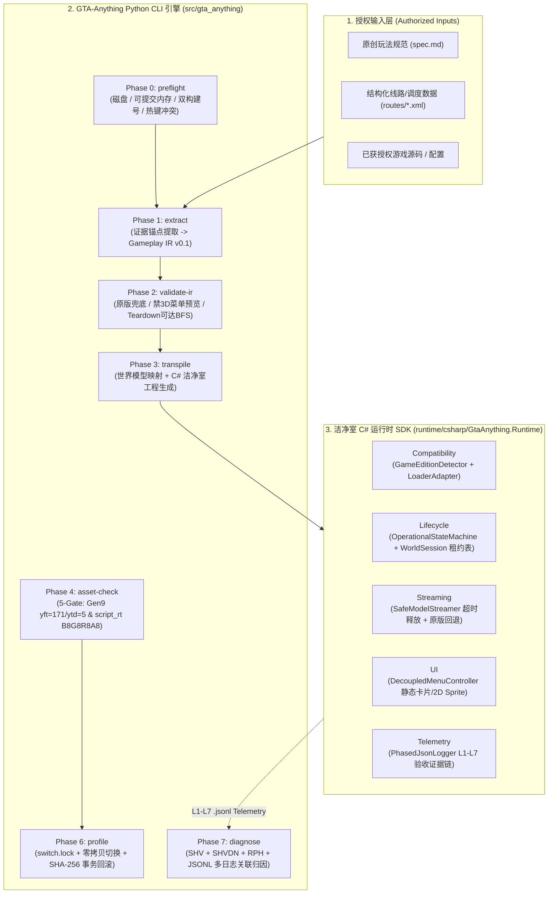
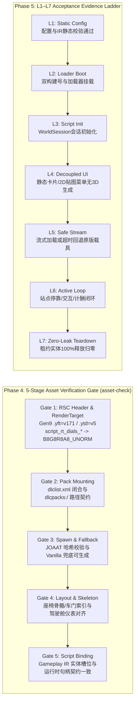

<div align="center">

# 🌆 GTA-Anything

**Turn Any Authorized Gameplay Spec, Route Data, or Open-Source Mechanics into a Playable GTA World-Model Mod.**

**以 GTA 开放世界为通用「世界模型载体」的 Agent-Native 玩法提取、洁净室转译与可逆部署验证框架**

[](LICENSE)
[](pyproject.toml)
[](runtime/csharp/GtaAnything.Runtime)
[](docs/ARCHITECTURE.md)
[](tests/TEST.md)
[](HARNESS.md)
[](docs/LESSONS_LEARNED.md)

<p align="center">
  <a href="#-设计理念为什么以-gta-作为通用世界模型载体">设计理念</a> ·
  <a href="#-三大范式融合-paradigm-synthesis">三大范式融合</a> ·
  <a href="#-系统架构与门禁阶梯-system-architecture">系统架构</a> ·
  <a href="#-8阶段-agent-标准作业管线-8-phase-harness">8阶段管线</a> ·
  <a href="#-60秒快速上手-60-second-quickstart">60秒快速上手</a> ·
  <a href="#-ai-coding-agent-技能接入-agent-integration">Agent技能接入</a> ·
  <a href="#-内置洁净室标杆示例-clean-room-examples">标杆示例</a> ·
  <a href="#-演进路线图-roadmap-m0m3">路线图</a> ·
  <a href="#-english-overview">English Overview</a>
</p>

</div>

---

## 💡 设计理念：为什么以 GTA 作为通用「世界模型载体」？

为什么要从零手写刚体车辆物理、交通流 AI、道路寻路网格 (NavMesh)、昼夜天气光照与第三人称镜头系统？  
**Grand Theft Auto V (Enhanced Gen9 & Legacy Gen8)** 本身就是一个历经十年工业级打磨的**三维交互世界模型基底 (Universal World-Model Substrate)**。

然而，当开发者尝试用大模型直接“Vibe Coding”生成 GTA 玩法脚本或混装资产时，几乎都会撞上**四大工程死穴**：菜单预览崩溃、流式句柄泄漏、Gen9 资产闪退与多模组混装污染。**`GTA-Anything`** 将经验法则固化为**编译器级形式化不变量 (`Gameplay IR`) + 洁净室 C# 运行时 (`GtaAnything.Runtime`) + 5 道静态资产门禁**：

| 传统盲写 / Vibe-Coded 脚本死穴 | 真实故障根因 (Root Cause) | `GTA-Anything` 架构级工程解药 |
| :--- | :--- | :--- |
| **1. 菜单滚动立刻崩溃 (`NullReferenceException`)** | 在 `OnIndexChange` 菜单回调中同步调用 `CreateVehicle` 生成 3D 预览车；模型未就绪返回 `null` 后直接访问属性或高频刷车撑爆流式池 | **UI 与实体生成强制解耦 (`UI-Spawn Decoupling`)**：G-IR 编译器静态拒绝 `live_3d_spawn`；`DecoupledMenuController` 强制仅允许静态元数据卡片或 2D Sprite 贴图预览，实体生成推迟到 `ConfirmSelection` |
| **2. 第三方车辆流式加载超时死锁 / 退游挂死** | Add-on 车辆在 `dlclist.xml` 登记后流式请求超时，脚本未调用 `MarkAsNoLongerNeeded` 留下悬空句柄，导致后续流式请求全部阻塞 | **原版基线先行 + 流式超时自动释放 (`SafeModelStreamer`)**：每个实体槽强制声明 `vanilla_fallback_model`（如 `bus` / `mule`），超时立即调用 `ReleaseModelRequest` 释放句柄并平滑降级至原版模型 |
| **3. Gen8 老资产放进 GTA V Enhanced 秒退** | Gen9 严格要求 `.yft` (`v171`) / `.ytd` (`v5`)，且 `script_rt_dials_*` 车载仪表渲染目标若沿用 `DXT1` 压缩格式会直接触发 D3D12 渲染管线崩溃 | **5 道独立资产门禁 (`5-Gate Gen8/Gen9 Asset Auditor`)**：离线静态解析 RSC7/RSC8 头部与纹理字节，精准拦截 `script_rt_dials_*` 的 `DXT1` 格式并指导转换为单 mip `B8G8R8A8_UNORM` |
| **4. 多套模组混装抢键、虚存耗尽、无法回滚** | `RPH` (`F4`) 与 `SHVDN` (`Insert`) 双加载链混装、游戏Exe磁盘版本与 SHV 枚举别名混淆、系统可提交内存低于 `1 GB` 引发无日志闪退 | **环境预检 (`preflight`) + 事务级 Profile 隔离 (`ProfileManager`)**：检测磁盘/可提交内存/双构建号，基于 `switch.lock`、原地零拷贝移动与 SHA-256 清单实现秒级切换与一键原子回滚 |

---

## 🧬 三大范式融合 (Paradigm Synthesis)

`GTA-Anything` 汲取并融合了三个标杆开源工程的核心思想，将 GTA 模组开发从“手工作坊脚本”升级为**确定性 Agent 编译管线**：

| 灵感源范式 | 核心工程哲学 | 在 `GTA-Anything` 中的落地实现 |
| :--- | :--- | :--- |
| **[`HKUDS/CLI-Anything`](https://github.com/HKUDS/CLI-Anything)** | **Agent-Native Harness & Structured CLI**<br>让任何专业软件通过标准 SOP 与 `--json` CLI 成为 AI Agent 的确定性工具 | 提供 8 阶段 [`HARNESS.md`](HARNESS.md) 方法论、全命令支持 `--json` 输出的 `gta-anything` CLI，以及开箱即用的 [`skills/gta-anything/SKILL.md`](skills/gta-anything/SKILL.md) 技能包 |
| **[`morluto/rea`](https://github.com/morluto/rea)**<br>*(Reverse Engineer Anything)* | **Evidence-Backed Mechanism Extraction**<br>拒绝大模型幻觉，每一条提取出的状态机与参数必须绑定源码/文档行级证据锚点 | `extract` 阶段将 Markdown 玩法规范、XML 线路数据或授权源码解析为 **`Gameplay IR (G-IR v0.1)`**，并强制携带 `EvidenceAnchor` (`source_file` + `locator` + `confidence`) |
| **[`boykopovar/AnyPS5`](https://github.com/boykopovar/AnyPS5)** & **`XenonRecomp`** | **Clean-Room Runtime & Static Re-targeting**<br>零专有二进制分发，通过洁净室兼容层抹平底层代际 ABI 差异并静态校验二进制资产 | 100% 原创 MIT 洁净室 C# 运行时 (`GtaAnything.Runtime`)，内置 Gen9 (`GTA5_Enhanced.exe`) / Gen8 双代际条件编译与 RSC7/RSC8 资产静态审计器 |

---

## 🏗️ 系统架构与门禁阶梯 (System Architecture)



### 🛡️ 五道资产门禁 (`5-Stage Asset Gate`) & 七层验收证据阶梯 (`L1`–`L7`)



---

## 🔄 8阶段 Agent 标准作业管线 (8-Phase Harness)

完整 SOP 规范详见 [`HARNESS.md`](HARNESS.md)：

| 阶段 | CLI 子命令 | 核心职责与形式化守卫 | 产物 / 证据输出 |
| :--- | :--- | :--- | :--- |
| **Phase 0** | `preflight` | 校验磁盘余量、Windows 可提交内存 (`CommitLimit - CommitTotal`)、游戏未运行、双构建号（磁盘 `1.0.1158.16` vs SHV `VER_EN_1_0_1158_13`）及热键冲突 | `PreflightReport` JSON |
| **Phase 1** | `extract` | 从 `spec.md`、`routes/*.xml` 或授权源码提取状态机、实体槽位与空间轨迹，绑定行级 `EvidenceAnchor` | `gameplay_ir.json` |
| **Phase 2** | `validate-ir` | 图论 BFS 验证所有状态可达且所有活跃态均存在有向路径到达 `Teardown`；静态拦截 `live_3d_spawn` 与空 `vanilla_fallback_model` | `ValidationReport` JSON |
| **Phase 3** | `transpile` | 将 G-IR 映射至 GTA 世界模型契约，生成支持 `GTAV_ENHANCED` / `GTAV_LEGACY` 条件编译的 C# 模组工程 | `.csproj` + `ModEntrypoint.cs` + `BUILD_AND_VERIFY.md` |
| **Phase 4** | `asset-check` | 离线执行 5 道资产兼容门禁，识别 Gen8/Gen9 版本错配与 `script_rt_dials_*` `DXT1` 崩溃隐患 | `AssetAuditReport` JSON |
| **Phase 5** | *(Runtime)* | `PhasedJsonLogger` 在模组运行期按 `L1`–`L7` 阶梯自动落盘结构化 `.jsonl` 遥测证据 | `<mod_id>_telemetry.jsonl` |
| **Phase 6** | `profile` | 基于 `switch.lock`、进程守卫与 `Inactive/<profile>` 停靠区执行可逆 Profile 暂存、激活与 SHA-256 校验回滚 | `DeploymentManifest` JSON |
| **Phase 7** | `diagnose` | 关联分析 `ScriptHookV.log`、`ScriptHookVDotNet.log`、`RagePluginHook.log` 与 `.jsonl` 遥测，输出根因分类与修复建议 | `DiagnosticReport` JSON |

---

## ⚡ 60秒快速上手 (60-Second Quickstart)

### 1. 安装 (`Python 3.10+`)

```bash
pip install -e ".[dev]"
```

### 2. 一键运行端到端全链路管线 (`Extract -> Validate -> Transpile -> Asset-Check`)

```bash
gta-anything --json pipeline examples/metro_shuttle_loop/spec.md \
  -o build/metro_pipeline \
  --edition enhanced_gen9
```

### 3. 分阶段精细化 `--json` CLI 操控

```bash
# Phase 0: 环境、可提交内存、双构建号与热键冲突预检
gta-anything --json preflight --hotkey F9

# Phase 1: 从 Markdown 玩法规范 + XML 线路表提取带证据锚点的 Gameplay IR
gta-anything --json extract examples/metro_shuttle_loop/spec.md -o build/metro_ir.json

# Phase 2: 静态校验 Gameplay IR 安全不变量（BFS Teardown 可达性 / 禁 3D 预览 / 原版兜底）
gta-anything --json validate-ir examples/metro_shuttle_loop/gameplay_ir.json

# Phase 3: 转译为洁净室 C# 模组工程（对接 GtaAnything.Runtime）
gta-anything --json transpile examples/metro_shuttle_loop/gameplay_ir.json -o build/MetroShuttleLoop

# Phase 4: 5-Gate 静态资产兼容审计（Gen9 .yft v171 / .ytd v5 / script_rt_* B8G8R8A8_UNORM）
gta-anything --json asset-check examples/metro_shuttle_loop --edition enhanced_gen9

# Phase 6: 可逆 Profile 暂存、切换与回滚（支持 --dry-run 零写入演练）
gta-anything --json profile stage transit --game-dir ./mock_gtav --build-dir build/MetroShuttleLoop --dry-run

# Phase 7: 多日志关联归因诊断（联合分析 SHV + SHVDN + JSONL + 系统可提交内存）
gta-anything --json diagnose logs/ScriptHookV.log logs/ScriptHookVDotNet.log --commit-mb 2048
```

### 4. 编译洁净室 C# 运行时与生成模组 (`.NET SDK`)

```bash
# 编译核心运行时兼容层 SDK (netstandard2.0)
dotnet build runtime/csharp/GtaAnything.Runtime/GtaAnything.Runtime.csproj -c Release

# 编译转译出的模组工程（支持 EnhancedGen9 / LegacyGen8 条件编译）
dotnet build build/MetroShuttleLoop/MetroShuttleLoop.csproj -c Release -p:Edition=EnhancedGen9
```

### 5. 运行离线自动化测试套件 (`25/25 Passed`)

```bash
pytest -v
```

---

## 🤖 AI Coding Agent 技能接入 (Agent Integration)

`GTA-Anything` 原生面向 **Claude Code**、**OpenAI Codex**、**Google Antigravity** 与 **Cursor** 等 AI 编程智能体设计，内置完整的方法论契约 [`HARNESS.md`](HARNESS.md) 与技能定义 [`skills/gta-anything/SKILL.md`](skills/gta-anything/SKILL.md)。

### 在 Agent 中挂载 `/gta-anything` 技能

```bash
# 方式 1：将技能目录软链或复制至 Claude Code / Antigravity / Codex 技能发现目录
cp -r skills/gta-anything ~/.claude/skills/

# 方式 2：在对话中直接指令 Agent 加载本地 HARNESS 与 SKILL
```

**向 AI Agent 发送的标准提示词示例**：

> 请阅读仓库根目录的 `HARNESS.md` 与 `skills/gta-anything/SKILL.md`，严格遵循 `/gta-anything` 8 阶段 SOP：  
> 1. 将我的玩法设计文档 `examples/harbor_courier_dispatch/spec.md` 提取并校验为 `Gameplay IR`；  
> 2. 确保遵循 **Vanilla-First 原版兜底**、**UI-Spawn 解耦**与 **`WorldSession` 租约式清理**三大不变量；  
> 3. 调用 `gta-anything --json pipeline` 生成面向 `enhanced_gen9` 的 C# 模组工程并输出 L1–L7 验收报告。

---

## 🎮 内置洁净室标杆示例 (Clean-Room Examples)

所有示例均 **100% 原创**，默认绑定 GTA V 原版内置实体名称（零外部商业资产依赖即可跑通完整闭环）：

| 标杆示例 | 玩法范式 | 原版兜底实体 (`Vanilla-First`) | 核心机制与状态机闭环演示 |
| :--- | :--- | :--- | :--- |
| **[`examples/metro_shuttle_loop/`](examples/metro_shuttle_loop/README.md)** | 城市公共交通环线运营<br>*(Fixed-Route Urban Transit)* | `bus` / `airbus` + `a_m_y_business_01` | 8 站市中心环线 (`routes/ls_downtown_loop.xml`)、`static_sprite` 选线菜单、`SafeModelStreamer` 5000ms 超时回退、进站停靠计时、车门控制与乘客上下车、票价结算、`WorldSession` 收车全量清理 |
| **[`examples/harbor_courier_dispatch/`](examples/harbor_courier_dispatch/README.md)** | 港区货运执勤与调度响应<br>*(On-Duty Dispatch & Verification)* | `mule` / `benson` + `s_m_m_dockwork_01` | 上班打卡 (`On-Duty`)、接警调度派单、驾驶货运卡车前往洛圣都港区核验点 (`routes/ls_port_zones.xml`)、与调度员 NPC 交互核验、结案计酬、下班一键释放全部租约句柄 |

---

## 📂 仓库目录结构 (Repository Tree)

```text
GTA-Anything/
├── pyproject.toml                         # PEP 621 打包定义与 `gta-anything` CLI 入口
├── README.md                              # 项目总览、架构图与快速上手指南
├── HARNESS.md                             # Agent 8 阶段标准作业程序 (SOP)
├── LICENSE                                # MIT 开源许可证
├── docs/
│   ├── ARCHITECTURE.md                    # 系统架构、9 大硬性不变量与模块契约
│   ├── GAMEPLAY_IR_SPEC.md                # Gameplay IR (G-IR v0.1) 形式化 Schema 规范
│   ├── LESSONS_LEARNED.md                 # GTA V Gen9/Gen8 模组工程避坑与排错宝典
│   └── ROADMAP.md                         # M0-M3 演进路线图
├── skills/
│   └── gta-anything/
│       ├── SKILL.md                       # AI Agent 可发现技能定义 (`/gta-anything`)
│       └── templates/                     # MOD_SOP.md 与 7 层验收 TEST.md 模板
├── src/gta_anything/
│   ├── cli.py                             # Click 统一命令行入口（全命令支持 `--json`）
│   ├── models/                            # GameplayIR, ValidationReport, DeploymentManifest
│   ├── preflight/                         # 磁盘/可提交内存/双构建号/热键冲突预检器
│   ├── extractor/                         # Markdown/XML/源码 证据锚点提取器
│   ├── transpiler/                        # GTA 世界模型映射器与 C# 洁净室代码生成器
│   ├── assets/                            # 5-Gate Gen8/Gen9 RSC7/RSC8 资产静态审计器
│   ├── deploy/                            # 可逆 Profile 隔离、文件锁与原子切换管理器
│   └── diagnose/                          # SHV/SHVDN/RPH/JSONL 多日志关联诊断器
├── runtime/csharp/GtaAnything.Runtime/    # 洁净室 C# 运行时 SDK (netstandard2.0, 零专有二进制)
├── examples/                              # 100% 洁净室原创双标杆示例 (公交环线 + 港区货运调度)
└── tests/                                 # Pytest 25 项单元与 CLI 端到端测试套件 + TEST.md 报告
```

---

## 🗺️ 演进路线图 (Roadmap `M0`–`M3`)

详细规划见 [`docs/ROADMAP.md`](docs/ROADMAP.md)：

- [x] **`M0` — 核心架构基座、Python CLI 引擎、C# 洁净室运行时与 Agent Skill (`v0.1.0`, 已完成)**：交付 `Gameplay IR v0.1`、8 阶段 `gta-anything --json` CLI、`GtaAnything.Runtime` C# SDK、5-Gate 资产静态审计器、可逆 Profile 管理器、多日志诊断器、两套原创标杆示例及 25 项自动化测试。
- [ ] **`M1` — GTA V Enhanced (Gen9) & Legacy (Gen8) 深度编译与双加载链扩展 (`v0.2.0`)**：接入 `.NET SDK` 自动编译产物 IL/JIT 静态引用检查、扩充 `RAGE Plugin Hook (RPH)` 后端适配器、内置全量原版语义字典与 2D Sprite 菜单预览卡打包脚手架。
- [ ] **`M2` — 多源逆向提取器 (`REA` 联动) 与资产转换自动化 (`v0.3.0`)**：集成 Tree-sitter AST 解析器与 MCP 逆向桥接接口、对接外部资产批处理工具链（Gen8 → Gen9 `script_rt_*` 单 mip `B8G8R8A8_UNORM` 自动重编码脚手架）及 Web 状态拓扑预览器。
- [ ] **`M3` — 跨载体世界模型生态与社区 Hub (`GTA-Anything Hub`, `v0.4.0`)**：支持输出 FiveM / RAGE MP 目标后端、抽象跨代 `WorldHostAdapter` 接口，构建零专有二进制分发的洁净室玩法包注册表。

---

## 🌐 English Overview

**GTA-Anything** is an Agent-Native framework that turns **Grand Theft Auto V (Enhanced / Gen9 & Legacy / Gen8)** into a general-purpose **World-Model Host** for authorized gameplay specifications, structured route/dispatch datasets, and open-source game mechanics.

### Key Highlights

1. **Synthesizes Three Proven Open-Source Paradigms**:
   - **[`CLI-Anything`](https://github.com/HKUDS/CLI-Anything)**: 8-phase Agent Standard Operating Procedure ([`HARNESS.md`](HARNESS.md)), discoverable skill ([`skills/gta-anything/SKILL.md`](skills/gta-anything/SKILL.md)), and structured `--json` CLI (`gta-anything`).
   - **[`REA (Reverse Engineer Anything)`](https://github.com/morluto/rea)**: Evidence-backed mechanism extraction into **Gameplay IR (`G-IR v0.1`)** where every extracted state, route, and entity slot is anchored to source files and line numbers (`EvidenceAnchor`).
   - **[`AnyPS5`](https://github.com/boykopovar/AnyPS5) & `XenonRecomp`**: A 100% clean-room C# runtime compatibility layer ([`GtaAnything.Runtime`](runtime/csharp/GtaAnything.Runtime)) and static binary asset auditor bridging **GTA V Legacy (Gen8)** and **GTA V Enhanced (Gen9)**.
2. **Eliminates the Top 4 Modding Crash Patterns by Construction**:
   - **UI-Spawn Decoupling**: Statically blocks `live_3d_spawn` during menu scrolling (`OnIndexChange`), preventing `NullReferenceException` when `CreateVehicle` returns `null`.
   - **Vanilla-First Stream Timeout Guard (`SafeModelStreamer`)**: Enforces a valid `vanilla_fallback_model` on every entity slot and releases timed-out model requests (`MarkAsNoLongerNeeded`) before falling back.
   - **5-Stage Gen8/Gen9 Asset Gate (`asset-check`)**: Audits RSC7/RSC8 `.yft` (`v171`) and `.ytd` (`v5`) headers offline and flags legacy `DXT1` `script_rt_dials_*` render targets that must be converted to single-mip `B8G8R8A8_UNORM` on Gen9.
   - **Transactional Profile Isolation (`profile`)**: File-locked (`switch.lock`), zero-copy profile switching with SHA-256 manifest verification and instant rollback.

---

## ⚖️ 洁净室与非官方关联声明 (Clean-Room & Non-Affiliation Disclaimer)

1. **100% 原创洁净室代码 (`MIT License`)**：本仓库所有 Python 引擎代码、C# 运行时 SDK (`GtaAnything.Runtime`)、Gameplay IR 规范与示例数据均为 100% 原创洁净室实现，采用 [MIT License](LICENSE) 开源。
2. **零专有二进制与受版权保护资产**：本仓库**不包含、不分发、也不修改**任何 Rockstar Games 或 Take-Two Interactive 的专有二进制文件（无 `.exe`、`.dll`、`.asi`、`.rpf`、`.yft`、`.ytd`），也不包含任何未经授权的第三方模组资产。
3. **非官方独立工程项目**：`GTA-Anything` 是面向 AI Agent 与模拟世界模型研究的独立开源工具链，与 **Rockstar Games**、**Take-Two Interactive** 或任何第三方商业模组作者**不存在任何隶属、赞助或官方背书关系**。"Grand Theft Auto" 与 "GTA V" 均为其各自权利人的注册商标。
