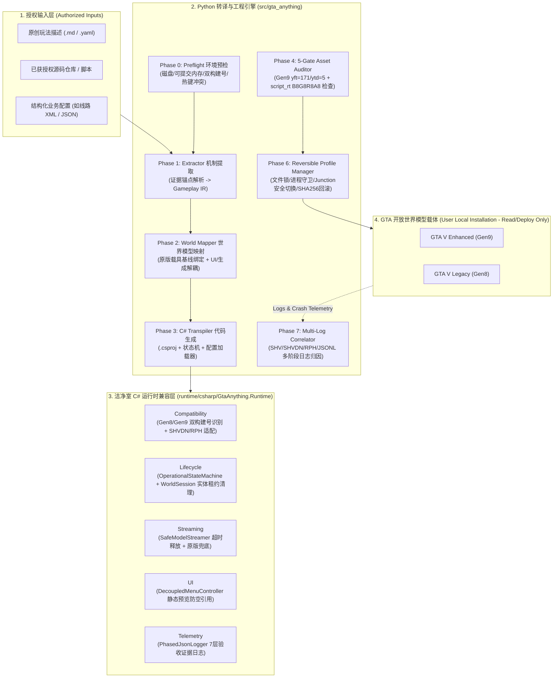

# GTA-Anything 系统架构与模块契约规范 (Architecture & Interface Contracts)

> **定位**：以 GTA 开放世界为通用「世界模型载体 (World-Model Host)」的 **Agent-Native 玩法机制提取、中间表示转译、兼容层适配与可逆部署验证框架**。  
> **当前主目标**：GTA V（同时支持 **Enhanced / Gen9** 与 **Legacy / Gen8** 双版本差异），架构预留多代 GTA 及 RAGE 生态扩展能力。

---

## 1. 开源参考范式融合设计 (Reference Paradigm Synthesis)

`GTA-Anything` 并非简单的「让大模型直接瞎写一段 GTA 脚本」，而是融合了三大前沿 AI 驱动工程/转译开源项目的核心架构思想：

| 参考项目 | 核心思想提炼 | 在 `GTA-Anything` 中的架构映射 |
| :--- | :--- | :--- |
| **`CLI-Anything`** (`HKUDS/CLI-Anything`) | `HARNESS.md` 多阶段标准作业程序 (SOP) + 统一 `--json` 结构化 CLI + 自动生成 `SKILL.md`，让任意软件成为 Agent-Native 可操控对象 | **`HARNESS.md` 8 阶段管线 + `gta-anything` CLI + `skills/gta-anything/SKILL.md`**：将任意授权玩法输入标准化地构建、验证、部署与诊断，全命令支持 `--json` 供 Agent 闭环调用 |
| **`REA — Reverse Engineer Anything`** (`morluto/rea`) | 不把百万行代码硬塞进上下文，而是通过结构化分析器提取**带证据锚点 (Evidence-Backed)** 的控制流、状态与数据结构，再做洁净室重构 | **`extractor` 玩法机制提取层 + `Gameplay IR (G-IR)`**：从玩法设计文档、开源/授权游戏源码或配置表（如线路 XML、任务配置）中提取带来源证据的状态机、角色拓扑与交互契约，杜绝盲目幻觉生成 |
| **`AnyPS5` & `XenonRecomp`** (`boykopovar/AnyPS5`, `hedge-dev/XenonRecomp`) | **洁净室运行时兼容层 (Clean-Room Runtime)** + **符号/ABI 重链接 (Relinker)** + **着色器/资产重定目标 (Shader & Asset Re-targeting)**，仓库零私有版权二进制 | **`GtaAnything.Runtime` C# 洁净室 SDK + `assets` Gen8/Gen9 资产静态审计器**：屏蔽 Enhanced (Gen9) 与 Legacy (Gen8)、SHVDN v2/v3/Enhanced 与 RPH 的底层差异；静态审计 `.yft`(v171)/`.ytd`(v5) 与 `script_rt_*` 渲染目标格式 (`DXT1` vs `B8G8R8A8_UNORM`)；公开仓库 100% 洁净室原创代码 |

---

## 2. 端到端系统分层架构 (Layered Architecture)



---

## 3. 核心工程铁律 (Hard Engineering Invariants)

所有模块与子 Agent 生成的代码必须严格遵守以下从真实排错实践中提炼的架构铁律：

1. **洁净室与开源合规边界 (Clean-Room & Licensing Boundary)**：
   - 严禁在仓库中包含任何 Rockstar 原生二进制、第三方未授权 `.dll`/`.asi`/`.rpf`/`.yft`/`.ytd` 或包含个人路径的本地日志。
   - 所有内置示例（`examples/`）必须使用 100% 原创配置与 GTA 原版内置实体名（如 `bus`, `airbus`, `coach`, `mule`, `police`）作为可玩基线。
2. **双构建号与双加载链显式建模 (Dual Build ID & Dual Loader Chains)**：
   - 同时保留并区分 **磁盘可执行文件构建号**（如 `1.0.1158.16`）与 **Script Hook V 内部枚举别名**（如 `VER_EN_1_0_1158_13`）。
   - 明确区分两条独立加载链：
     - **SHVDN/ASI 链**：`dinput8.dll/ASI Loader` → `ScriptHookV.dll` → `ScriptHookVDotNet.asi` (`v2` / `v3` / `Enhanced`) → `scripts/` + `mods/` (`OpenRPF.asi`)。
     - **RPH 链**：`RAGEPluginHook.exe` → `plugins/`（如 `LSPDFR`）。
3. **「完整运营闭环」优先于「玩具式单步动作」 (Full Operational Lifecycle)**：
   - 玩法转译必须完整表达：`配置读入 (ConfigLoaded)` → `菜单选配 (MenuSelecting)` → `世界资源请求 (ResourceStreaming)` → `实体生成与就位 (Spawning)` → `核心任务/班次循环 (ActiveOperation: 站序/检查点/交互/计费)` → `正常完结或异常中止 (Completing/Aborting)` → `确定性清理 (Teardown)`。
4. **菜单 UI 与重型实体生成彻底解耦 (UI-Spawn Decoupling)**：
   - **严禁**在菜单滚动回调（如 `OnIndexChange`）中同步或异步调用 `CreateVehicle` 生成 3D 预览车（极易因流式加载未就绪返回 `null` 触发 `NullReferenceException` 或耗尽内存）。菜单阶段仅允许展示静态元数据与 2D 贴图/Sprite。
5. **原版基线先行 + 模型流式超时释放兜底 (Vanilla Baseline & Stream Release)**：
   - 每个角色/载具槽位必须声明 `vanilla_fallback_model`（如双层巴士加载超时自动回退原版 `bus`）。
   - 流式请求模型超时后，**必须立即释放模型请求**（`Model.MarkAsNoLongerNeeded()`），防止残留悬空流式句柄拖垮后续渲染或退出阶段。
6. **五道独立资产验证门禁 (5-Stage Asset Gates)**：
   - `Gate 1` 静态二进制审计（Gen9 `.yft` 版本 `171`、`.ytd` 版本 `5`；检查 `script_rt_*` 仪表渲染目标贴图在 Gen9 下是否为单 mip `B8G8R8A8_UNORM`，拦截遗留 `DXT1`）→ `Gate 2` DLC 登记核验（`dlclist.xml`）→ `Gate 3` 引擎模型流式载入 → `Gate 4` 世界生成与非空校验 → `Gate 5` 座位/车门/NPC 上下车交互验证。
7. **租约式实体生命周期清理 (`WorldSession`)**：
   - 模组只能清理自己注册到 `WorldSession` 租约表中的 `Vehicle`、`Ped`、`Blip`、`Camera`、`Prop`，严禁全局无差别清除世界实体以免破坏其他共存插件或故事模式状态。
8. **可逆 Profile 隔离与环境预检 (Reversible Profiles & Environment Preflight)**：
   - 部署与切换前强制检查：目标盘剩余空间（防止数 GB `.rpf` 撑爆磁盘）、系统可提交内存余量（`CommitLimit - CommittedBytes`，低于 `1536 MB` 告警，低于 `1024 MB` 阻断高负载测试）、游戏进程未运行（`GTA5_Enhanced`, `GTA5`, `PlayGTAV`, `RAGEPluginHook`）、独占文件锁与 NTFS Junction 安全移动。

---

## 4. 目录结构与精确模块接口契约 (Module Interface Contracts)

为保证多模块协同零冲突，Python 包 `gta_anything`（位于 `src/gta_anything/`）各子模块必须严格实现以下导出签名与返回字典结构：

### 4.1 `gta_anything.models.ir` & `gta_anything.models.manifest`
- **`GameplayIR`** (dataclass, 支持 `to_dict()` / `from_dict(data)` / `to_json()` / `from_json()`):
  - `schema_version: str` (默认 `"0.1.0"`)
  - `meta: ModMeta` (`id`, `name`, `version`, `author`, `license`, `description`, `source_kind`, `target_editions`: `list[str]`)
  - `loader_target: str` (`"shvdn_v3"` | `"shvdn_enhanced"` | `"rph"`)
  - `inputs: InputBindings` (`activation_key: str`, `modifier_key: str | None`, `menu_library: str`, `avoid_conflicts_with: list[str]`)
  - `entities: list[EntitySlot]` (`slot_id`, `role`, `vanilla_fallback_model`, `preferred_addon_model: str | None`, `stream_timeout_ms: int = 5000`, `is_player_vehicle: bool = False`)
  - `routes_or_zones: list[SpatialTrack]` (`track_id`, `name`, `mode`: `"ordered_stops"` | `"dispatch_zones"`, `stops: list[StopNode]`, `fare_or_reward: int = 0`, `allowed_vehicle_slots: list[str]`)
  - `state_machine: StateMachineSpec` (`initial_state: str`, `states: list[StateNode]`, `transitions: list[TransitionEdge]`, `cleanup_state: str = "Teardown"`)
  - `ui_spec: MenuUISpec` (`title`, `subtitle`, `preview_mode`: 固定允许 `"static_metadata"` | `"static_sprite"`, 严禁 `"live_3d_spawn"`)
  - `evidence: list[EvidenceAnchor]` (`source_file`, `locator`, `extracted_fact`, `confidence`)
- **`validate_gameplay_ir(ir: GameplayIR | dict) -> ValidationReport`**:
  - `ValidationReport`: `valid: bool`, `errors: list[str]`, `warnings: list[str]`, `checked_invariants: list[str]`（包含：必须存在 `vanilla_fallback_model`、`preview_mode != "live_3d_spawn"`、状态机可达且所有运行态均可转移至 `cleanup_state`、许可证洁净室检查）。
- **`manifest.py`**:
  - `GameBuildIdentity` (`edition`: `"enhanced_gen9"` | `"legacy_gen8"`, `exe_version: str`, `shv_build_alias: str | None`, `exe_name: str`)
  - `LoaderChainSpec` (`chain_id`: `"shvdn"` | `"rph"`, `required_files: list[str]`, `log_files: list[str]`)
  - `DeploymentManifest` (`profile_name`, `mod_id`, `target_game_dir`, `edition`, `created_at`, `operations: list[dict]`, `sha256_map: dict[str, str]`)
  - `ACCEPTANCE_LAYERS: list[dict]`（定义 L1–L7 七层验收证据标准）。

### 4.2 `gta_anything.preflight.checker`
- **`run_preflight(game_dir: str | Path | None = None, min_free_gb: float = 10.0, min_commit_mb: float = 1536.0, hotkey: str | None = None) -> dict`**
  - 返回结构：
    ```python
    {
        "ok": bool,
        "timestamp": str,
        "system": {
            "os": str,
            "disk_drive": str,
            "disk_free_gb": float,
            "disk_ok": bool,
            "commit_available_mb": float | None,
            "commit_total_mb": float | None,
            "commit_ok": bool,
        },
        "game": {
            "provided": bool,
            "exists": bool,
            "edition": "enhanced_gen9" | "legacy_gen8" | "unknown",
            "exe_path": str | None,
            "exe_version": str | None,
            "shv_build_alias": str | None,
            "detected_loaders": list[str],
            "running_processes": list[str],
            "processes_clear": bool,
        },
        "hotkey_check": {
            "requested_hotkey": str | None,
            "conflicts": list[dict],  # e.g. RPH F4, SHVDN Insert, Trainer F3/F8, LSPDFR B/N/E/Y
        },
        "warnings": list[str],
        "errors": list[str],
    }
    ```

### 4.3 `gta_anything.extractor.analyzer`
- **`extract_gameplay_ir(source_path: str | Path, mod_id: str | None = None, target_edition: str = "enhanced_gen9") -> GameplayIR`**
  - 支持输入：
    1. 已有的 `.json` / `.yaml` IR 或结构化玩法定义文件；
    2. Markdown 玩法需求说明 (`spec.md`) + 同目录可选 `routes/*.xml`（支持解析线路名、站序、坐标 `x,y,z`、票价、绑定车型）；
    3. 源码目录（扫描 Python/C#/JS/XML/JSON 文件，提取状态枚举、配置表、动作函数并附带 `EvidenceAnchor` 行号/文件路径证据）。

### 4.4 `gta_anything.transpiler.world_mapper` & `csharp_codegen`
- **`map_ir_to_world(ir: GameplayIR) -> dict`**
  - 将 `GameplayIR` 映射为完整的 GTA 世界模型绑定表（校验并补全原版兜底载具哈希名、Blip Sprite/Color、座位索引、按键枚举、7 层遥测点）。
- **`generate_csharp_mod(ir: GameplayIR, output_dir: str | Path) -> dict`**
  - 在 `output_dir` 下生成完整、结构清晰、可直接编译的洁净室 C# 模组工程：
    - `<ModClassName>.csproj`（引用 `GtaAnything.Runtime` 与 SHVDN v3 / Enhanced 条件编译宏 `GTAV_ENHANCED` / `GTAV_LEGACY`）
    - `ModEntrypoint.cs`（继承/组合 `GtaAnything.Runtime`，严守配置加载 → 静态菜单 → 流式请求 → 任务循环 → `WorldSession.DisposeAll()`）
    - `<ModClassName>Config.json` 与路线/区域数据文件
    - `BUILD_AND_VERIFY.md`（7 层验收清单）
  - 返回：`{"ok": bool, "mod_id": str, "output_dir": str, "generated_files": list[str], "world_mapping": dict}`。

### 4.5 `gta_anything.assets.auditor`
- **`audit_assets(target_path: str | Path, target_edition: str = "enhanced_gen9") -> dict`**
  - 执行 **5-Stage Asset Gate** 静态阶段（Gate 1 & Gate 2）并生成 Gate 3–5 运行时检查单：
    - 支持扫描单个文件或目录（`.yft`, `.ytd`, `.dds`, `dlclist.xml`, `manifest.json`）：
      - 解析 RSC7 (`0x37435352`) / RSC8 头部及版本号：校验 Gen9 `.yft` (version `171`) 与 `.ytd` (version `5`) vs Gen8 常见版本（如 `.yft` `162`、`.ytd` `13`）。
      - 扫描纹理/二进制标记中的 `script_rt_`（特别是 `script_rt_dials_*` 仪表渲染目标）：若在 `enhanced_gen9` 下检测到 `DXT1` FourCC 标记或 mipCount > 1，明确报出高优兼容性错误并提示转换为单 mip `B8G8R8A8_UNORM`。
      - 校验 `dlclist.xml` XML 良构性与 `dlcpacks:/<name>/` 登记路径规范。
  - 返回：`{"ok": bool, "target_edition": str, "scanned_files": int, "gates": dict, "findings": list[dict], "summary": str}`。

### 4.6 `gta_anything.deploy.profile_manager`
- **`ProfileManager(game_dir: str | Path, profiles_root: str | Path | None = None)`**
  - 方法：
    - `stage_profile(profile_name: str, mod_build_dir: str | Path, loader_chain: str = "shvdn", dry_run: bool = False) -> dict`
    - `switch_profile(profile_name: str, dry_run: bool = False) -> dict`
    - `rollback(manifest_path: str | Path | None = None, dry_run: bool = False) -> dict`
    - `status() -> dict`
  - 核心机制：独占锁文件 `switch.lock`、游戏进程存活检测、非活跃 Profile 停靠区 (`Inactive/<profile>`)、NTFS 目录/Junction 原地移动 (`os.rename` 不展开拷贝目标大文件)、SHA-256 操作栈事务回滚、全程支持 `dry_run=True`。

### 4.7 `gta_anything.diagnose.log_correlator`
- **`diagnose_logs(log_paths: list[str | Path], commit_available_mb: float | None = None) -> dict`**
  - 解析并按时间戳关联：`ScriptHookV.log`（提取识别到的构建别名如 `VER_EN_1_0_1158_13`、fatal error）、`ScriptHookVDotNet.log`（提取 `NullReferenceException`、加载失败、未捕获异常栈）、`RagePluginHook.log`、以及 `GtaAnything.Runtime` 输出的分阶段 `.jsonl` 遥测日志。
  - 将问题归因分类为：`environment`（低可提交内存、DirectX 分配失败、磁盘满）、`loader`（版本不匹配、抢键、依赖缺失）、`asset`（模型流式超时、`script_rt` 格式崩溃）、`script_logic`（空引用、生命周期未清理）。
  - 返回：`{"ok": bool, "detected_build_alias": str | None, "highest_acceptance_layer_reached": int, "timeline": list[dict], "issues": list[dict], "recommendations": list[str]}`。

### 4.8 `gta_anything.cli` (Click 统一命令行入口)
- 入口命令：`gta-anything`（支持全局 `--json` 标志；无参数时打印清晰帮助概览）：
  - `gta-anything preflight [--game-dir PATH] [--hotkey KEY]`
  - `gta-anything extract <source_path> [-o gameplay_ir.json] [--edition enhanced_gen9|legacy_gen8]`
  - `gta-anything validate-ir <ir_path>`
  - `gta-anything transpile <ir_path> -o <out_dir>`
  - `gta-anything asset-check <path> [--edition enhanced_gen9|legacy_gen8]`
  - `gta-anything profile <status|stage|switch|rollback> ... [--dry-run]`
  - `gta-anything diagnose <log_paths...> [--commit-mb FLOAT]`
  - `gta-anything pipeline <source_path> -o <out_dir> [--edition ...]`（一键串联 Extract → Validate → Transpile → Asset-Check 离线全链路！）
