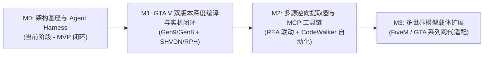

# GTA-Anything 项目演进规划与里程碑路线图 (Project Roadmap)

## 愿景总览

将 **GTA 开放世界**打造为通用的**玩法验证与模拟运行载体 (World-Model Runtime Substrate)**：用户只需提供原创玩法文档、结构化业务数据（如公交线网、物流调度单、赛事规则）或已获授权的游戏源码/脚本，AI Agent 即可通过 `GTA-Anything` 的标准化管线将其转译为高可靠、生命周期安全、可逆部署的 GTA 模组。

---

## 阶段规划 (Milestones)

### M0：核心架构基座、Python CLI 引擎、C# 洁净室运行时与 Agent Skill（已完成 v0.1.0 基座交付）
- [x] 确立融合 `CLI-Anything` + `REA` + `AnyPS5` 的三层转译架构与模块接口契约 (`docs/ARCHITECTURE.md`)
- [x] 制定 `Gameplay IR (G-IR v0.1)` 规范与静态安全不变量 (`docs/GAMEPLAY_IR_SPEC.md`)
- [x] 实现 `gta-anything` Python CLI 与七大核心子系统（全命令 `--json` 输出）：
  - `preflight`：磁盘空间、Windows 可提交内存、GTA V Enhanced/Legacy 双构建号探测、进程守卫与热键冲突检查
  - `extract`：从 Markdown 需求、XML 线路配置或源码仓库提取带证据锚点的 `Gameplay IR`
  - `validate-ir`：原版兜底、禁止菜单实时 3D 生成、状态机可达与 `Teardown` 安全回收校验
  - `transpile`：世界模型映射器 + SHVDN v3 / Enhanced 条件编译 C# 模组工程生成器
  - `asset-check`：5-Gate 资产静态审计器（RSC7/RSC8 `.yft` v171 / `.ytd` v5 版本检测、`script_rt_*` `DXT1` vs `B8G8R8A8_UNORM` 告警、`dlclist.xml` 核验）
  - `profile`：独占文件锁 + Junction 安全移动 + SHA-256 事务栈回滚的可逆部署与多模式切换器
  - `diagnose`：关联 `ScriptHookV.log`、`ScriptHookVDotNet.log`、`RagePluginHook.log` 与模组分阶段 `.jsonl` 证据日志的归因诊断器
- [x] 实现洁净室 C# SDK `GtaAnything.Runtime`（`WorldSession` 实体租约、`OperationalStateMachine`、`SafeModelStreamer`、`DecoupledMenuController`、`PhasedJsonLogger`）
- [x] 编写 `HARNESS.md`、`skills/gta-anything/SKILL.md` 及两套 100% 洁净室原创标杆示例（`metro_shuttle_loop` 城市公交环线运营 + `harbor_courier_dispatch` 港区调度执勤）
- [x] 完成完整离线单元测试与 CLI 端到端集成测试套件 (`pytest` 25/25 100% 通过)

### M1：GTA V Enhanced (Gen9) & Legacy (Gen8) 实机自动化编译与双加载链扩展
- [ ] 接入本地 `.NET SDK` 自动编译生成的 `.csproj` 产物的闭环校验器（含方法级 IL/JIT 静态引用检查）
- [ ] 扩充 `GtaAnything.Runtime` 的 **RAGE Plugin Hook (RPH)** 后端适配器，使同一份 `Gameplay IR` 可一键切换输出 `SHVDN` 脚本或 `RPH` 插件
- [ ] 内置丰富的 GTA 世界模型语义字典（全量原版载具分类、常用 NPC 职业模型、标准道路节点类型、原版音效与 Blip 预设库）
- [ ] 提供一键生成模组静态菜单预览卡（2D Sprite `.png` / `.ytd` 打包辅助脚本），彻底替代实时 3D 预览车

### M2：深度源码/二进制提取（REA 联动）与资产转换自动化
- [ ] 集成 Tree-sitter AST 解析器与可选 MCP 逆向桥接接口（兼容 `REA` 工作流），支持直接从 Unity/Godot/Python/JS 开源小游戏仓库自动提取完整状态机与数值表至 `Gameplay IR`
- [ ] 对接外部资产命令行工具链（如 CodeWalker / Sollumz 批处理接口），实现 Gen8 → Gen9 纹理（含 `script_rt_*` `B8G8R8A8_UNORM` 单 mip 重编码）自动修复建议与批处理脚手架
- [ ] 建立可视化 Gameplay IR 状态图与路线拓扑预览器（Web / HTML Widget）

### M3：跨载体世界模型生态与社区 Hub (`GTA-Anything Hub`)
- [ ] 支持输出 FiveM / RAGE MP 多人服务端+客户端同步脚本目标后端
- [ ] 抽象统一的 `WorldHostAdapter` 接口，向 GTA IV 及未来新一代 GTA 引擎平滑演进
- [ ] 构建类似 `CLI-Hub` 的洁净室玩法包注册表（只分发 `gameplay_ir.json` + 洁净室脚本源码，零侵权二进制分发）
